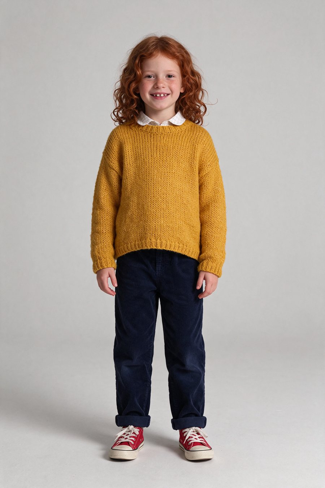
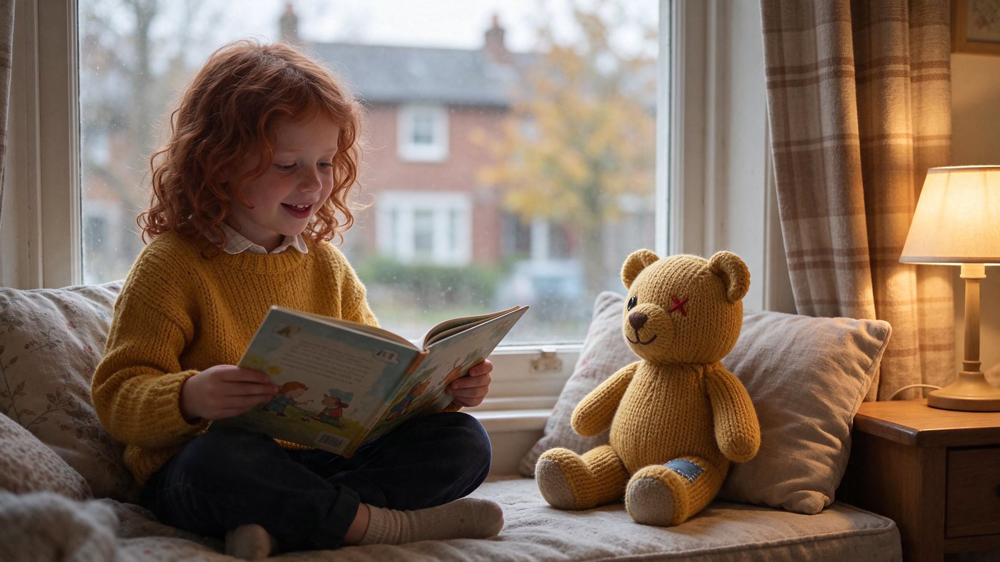
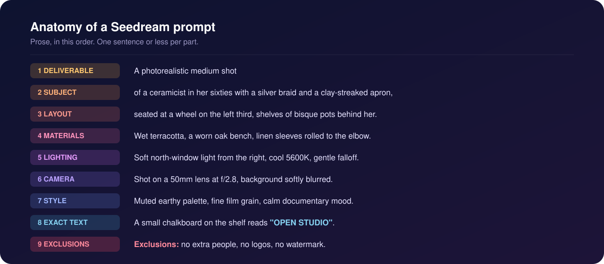

<div align="center">


<sub><i>This banner, including its title text, was generated by Seedream 5.5 with this skill. So is every image on this page.</i></sub>

<br><br>


# Seedream 5.5 Skill

**Your coding agent becomes an expert Seedream 5.5 prompter.**<br>
It works in Claude Code, Codex, Cursor, Gemini CLI, Copilot and about 70 other agents.

[](LICENSE)
[](https://agentskills.io/specification)


[](https://github.com/mazen320/seedream-5-5-skill/stargazers)

```bash
npx skills add mazen320/seedream-5-5-skill
```

**[Gallery](#gallery)** · **[How it prompts](#how-it-prompts)** · **[Install](#install)** · **[Failure modes](#the-failure-modes-it-catches)** · **[CLI](#use-the-script-directly)**

</div>

<br>

## Gallery

Every image here is a first render, with no cherry-picking or retouching. Each one links to its
**exact prompt and parameters**.

<table>
<tr>
<td width="50%" valign="top"><a href="assets/gallery/ceramicist.txt"></a><br><sub><b>Photoreal.</b> Lens, light and the chalkboard text, all from one prose prompt.</sub></td>
<td width="50%" valign="top"><a href="assets/gallery/dripper.txt"></a><br><sub><b>Product.</b> Studio light, a travertine surface, and negative space left for copy. <i>(Cropped from 1:1.)</i></sub></td>
</tr>
</table>
<table>
<tr>
<td width="33%" valign="top"><a href="assets/gallery/poster.txt"></a><br><sub><b>Exact text.</b> Every string is letter-perfect on the first try.</sub></td>
<td width="33%" valign="top"><a href="assets/gallery/bramble_sheet.txt"></a><br><sub><b>Asymmetry held.</b> One eye, not "fixed" into two.</sub></td>
<td width="33%" valign="top"><a href="assets/gallery/mila_sheet.txt"></a><br><sub><b>Character sheet.</b> A clean reference to reuse in later scenes.</sub></td>
</tr>
</table>

### Consistent characters, then one-change edits

| ① Two character sheets → one scene | ② "Change only one thing: add a red scarf" |
|:-:|:-:|
| [](assets/gallery/reading.txt) | [](assets/gallery/reading_scarf.txt) |
| Both identities stay separate, and the bear's single eye and knee patch survive. | Face, pose, room, light and framing are unchanged. Only the scarf is new. |

The full walkthrough is in [examples/03](examples/03-consistent-character.md).

<br>

## How it prompts

You describe what you want in plain words. The agent turns that into a structured prose prompt.
For example, the ceramicist above came from this prompt:



Then it:

1. **Picks a mode:** new image, edit, multi-reference composite, or another round of edits.
2. **Gives every reference image a role**, such as *"Image 1 provides the face; ignore its
   background."*
3. **Runs a pre-flight check** against known failure modes before spending a render.
4. **Renders and saves** the image next to a `.txt` file holding the exact prompt, the
   parameters and a hash of each reference.
5. **Reviews the result against your brief** and fixes one thing per round, restating what
   must stay the same.

<br>

## Why this skill

<table>
<tr>
<td width="33%" valign="top">

**🎯 Reference roles**<br>
It says what to take from each image and what to ignore, so backgrounds and props stop
leaking.

</td>
<td width="33%" valign="top">

**🔁 Edits without drift**<br>
Each round makes one change and repeats the full list of what to keep. The original image is
re-attached as an identity reference.

</td>
<td width="33%" valign="top">

**🧾 Reproducible**<br>
Every render gets a sidecar record. Re-run any image, or audit a whole edit chain.

</td>
</tr>
<tr>
<td valign="top">

**🛡️ Safe with your key**<br>
The key is read only from `ARK_API_KEY`. It is never printed, logged, saved or passed as a
flag, and it is removed from error text. Sidecars never store absolute paths.

</td>
<td valign="top">

**🧠 Light on context**<br>
`SKILL.md` is about 120 lines. Templates, API details and failure modes load only when the
agent needs them.

</td>
<td valign="top">

**📦 Nothing to install**<br>
One Python file, standard library only. Offline tests run in CI against a mock API.

</td>
</tr>
</table>

<br>

## The failure modes it catches

| | Problem | What goes wrong | What the skill does |
|:-:|---|---|---|
| 👁️ | **Asymmetric details** | A one-eyed toy grows a second eye | Names the side **from the viewer's point of view** and what replaces the missing eye, then repeats it in the exclusions |
| ↔️ | **"Its left" vs "image-left"** | Seedream mixes up whose left you mean, as our own test above showed | Says *image-left* / *image-right*, or *"exactly where it is in Image 1"* |
| 🍾 | **Rows of identical objects** | The count drifts and the shapes vary | Renders one object, then the copies are composited |
| 👥 | **More than 2 people** | Faces and outfits blend together | Keeps two people per frame, each with a reference and a screen position |
| 🔤 | **Text that will be animated** | Letters melt once a video model animates the frame | Keeps text out of the frame and adds it in post |
| 🌀 | **Long edit chains** | The subject's identity slowly drifts | Makes one change per round and re-attaches the original |

All of them, with symptoms and fixes, are in [`failure-modes.md`](skills/seedream-5-5/references/failure-modes.md).

<br>

## Install

<table>
<tr><th>Agent</th><th>How</th></tr>
<tr><td><b>Any agent</b></td><td><code>npx skills add mazen320/seedream-5-5-skill</code> (<a href="https://github.com/vercel-labs/skills">skills CLI</a>)</td></tr>
<tr><td><b>Claude Code</b></td><td><code>/plugin marketplace add mazen320/seedream-5-5-skill</code>, then <code>/plugin install seedream-5-5</code></td></tr>
<tr><td><b>Codex</b></td><td>Copy <code>skills/seedream-5-5/</code> to <code>~/.agents/skills/</code></td></tr>
<tr><td><b>Cursor</b></td><td>Copy it to <code>~/.cursor/skills/</code> or <code>.agents/skills/</code></td></tr>
<tr><td><b>Gemini CLI</b></td><td><code>gemini skills install https://github.com/mazen320/seedream-5-5-skill --path skills/seedream-5-5</code></td></tr>
<tr><td><b>Copilot</b></td><td>Copy it to <code>~/.copilot/skills/</code> or <code>.github/skills/</code></td></tr>
</table>

Then set your own BytePlus ModelArk key, with Seedream 5.5 enabled, in the shell your agent runs in:

```bash
export ARK_API_KEY=...            # PowerShell: $env:ARK_API_KEY = '...'
```

> [!IMPORTANT]
> Never paste your key into the chat. The skill tells the agent never to ask for it.

<br>

## Use the script directly

<details>
<summary><b>CLI reference</b></summary>

<br>

```bash
S=skills/seedream-5-5/scripts/seedream.py
python $S models                                        # Seedream model IDs for your key
python $S generate --prompt "..." --size 16:9 --out out --name hero
python $S generate --prompt-file p.txt --image a.png --image b.jpg --size 2:3
python $S generate --prompt "..." --dry-run              # print the request; no key, no cost
```

| Flag | Meaning |
|---|---|
| `--size` | `16:9` · `9:16` · `2:3` · `3:2` · `1:1`, or any `WxH` with an area of at least 921,600 px (the banner above is `3024x1296`) |
| `--image` | A path, URL or data URI. Repeat the flag for more images; they become Image 1, Image 2 and so on |
| `--model` | Default `dola-seedream-5-5-261028`, or set `SEEDREAM_MODEL` |
| `--name` | File stem. `_2`, `_3` and so on are added instead of overwriting |
| `--extra` | A JSON object of extra request fields, passed through as-is |

</details>

<details>
<summary><b>What's in the repo</b></summary>

<br>

```
skills/seedream-5-5/
├── SKILL.md                 core rules, mode picker, prompt structure, pre-flight checks
├── scripts/seedream.py      models · generate · --dry-run
└── references/
    ├── api.md               endpoint, fields, sizes, errors
    ├── prompting.md         9 templates
    └── failure-modes.md     failure modes, each with a fix
examples/                    3 worked examples with real results
assets/gallery/              every image on this page, each with its sidecar
tests/                       offline tests against a mock API
```

</details>

<br>

## Contributing

Found a new way Seedream breaks, or a better fix? Open an issue or PR. Include the prompt, the
sidecar `.txt` and what went wrong. A failure mode that comes with a tested fix is the most
valuable contribution.

```bash
python -m unittest discover -s tests -v
```

<br>

<div align="center">


If this skill saved you a render, **[give it a ⭐](https://github.com/mazen320/seedream-5-5-skill)**.

<sub>MIT licensed. Not affiliated with ByteDance or BytePlus. Model IDs, limits and pricing change, so check <code>seedream.py models</code>.<br>
Part of the prompt structure is adapted from the Seedream 5.5 guide in <a href="https://github.com/Evolink-AI/awesome-seedream-5-5-guide-and-prompt">Evolink-AI/awesome-seedream-5-5-guide-and-prompt</a> (CC BY 4.0).</sub>

</div>
