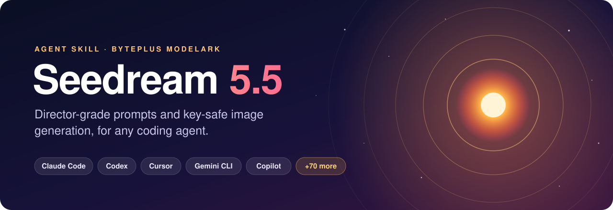
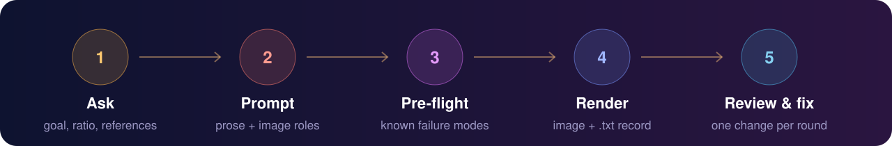

<div align="center">



<br>

[](.github/workflows/test.yml)
[](LICENSE)
[](https://agentskills.io/specification)


[](https://github.com/<you>/seedream-5-5-skill/stargazers)

**[Install](#-install)** · **[How it works](#-how-it-works)** · **[Examples](#-examples)** · **[Failure modes](#-the-failure-modes-it-catches)** · **[CLI](#-use-the-script-directly)**

</div>

<br>

Seedream 5.5 can produce stunning images, but it rewards a particular way of prompting.
This skill teaches your agent that method. The agent writes structured prose prompts, gives
each reference image a role, edits without drift, and checks for the mistakes that waste
renders, all before it calls the API. Install it once and it works in Claude Code, Codex,
Cursor, Gemini CLI, Copilot and about 70 other agents.

```bash
npx skills add <you>/seedream-5-5-skill
```

<br>

## ✦ How it works



You describe what you want in plain words, for example:

> *"Make a 2:3 poster for Lantern Street Night Market, 14–16 March, Harbour Square, with paper lanterns at dusk."*

The agent then:

1. picks a mode: new image, edit, several references, or another round of edits
2. writes the prompt from a template
3. checks the prompt against known failure modes
4. renders the image
5. compares the result to your brief, clause by clause

Each image is saved next to a `.txt` file that records exactly how it was made.

```text
out/night_market_poster.png
out/night_market_poster.txt   ← prompt, size, model, reference hashes, response metadata
```

<br>

## ✦ Prompts that follow how Seedream reads


The skill uses prose instead of tag soup and concrete visual facts instead of prestige words.
Hard exclusions always go last. Nine ready-made templates are included: photoreal, product,
poster, infographic, character sheet, composite, local edit, style transfer and video
keyframe.

<br>

## ✦ Why this skill

<table>
<tr>
<td width="50%" valign="top">

**🎯 Reference images with roles**<br>
Each reference gets a role, for example *"Image 1 provides the shape and logo; ignore its
background."* Backgrounds and props from one image stop leaking into the result.

</td>
<td width="50%" valign="top">

**🔁 Edits that don't drift**<br>
Each round makes one change and restates the full list of what to keep. The original image
is attached again as an identity reference.

</td>
</tr>
<tr>
<td valign="top">

**🛡️ Safe with your key**<br>
The key is read from `ARK_API_KEY` and nowhere else. It is never printed, logged, written
to a file or accepted as a flag, and it is removed from error text. Tests check this.

</td>
<td valign="top">

**🧾 Reproducible**<br>
Every render records the exact prompt, the parameters and the SHA-256 of each reference.
Re-run any image or audit a whole chain of edits.

</td>
</tr>
<tr>
<td valign="top">

**🧠 Light on context**<br>
`SKILL.md` is about 120 lines. The templates, the API details and the failure modes sit in
separate reference files that the agent reads only when it needs them.

</td>
<td valign="top">

**📦 Nothing to install**<br>
It is one Python file using only the standard library. The test suite runs offline against
a mock server in CI.

</td>
</tr>
</table>

<br>

## ✦ The failure modes it catches

| | Problem | What goes wrong | What the skill does |
|:-:|---|---|---|
| 👁️ | **Asymmetric details** | A one-eyed toy grows a second eye | Names which side and what replaces the missing eye, then repeats it in the exclusions |
| 🍾 | **Rows of identical objects** | The count drifts and the shapes vary | Renders one object, then the copies are placed in an editor |
| 👥 | **More than 2 people** | Faces and outfits blend together | Keeps two people per frame, each with a reference and a screen position |
| 🔤 | **Text that will be animated** | Letters melt once a video model animates the frame | Keeps text out of the frame so it can be added afterwards |
| 🌀 | **Long edit chains** | The subject's identity slowly drifts | Changes one thing per round and re-attaches the original image |
| 🧩 | **Reference leakage** | A reference's background bleeds into the image | States what to take from each image and what to ignore |

All eight, with symptoms and fixes, are in [`failure-modes.md`](skills/seedream-5-5/references/failure-modes.md).

<br>

## ✦ Install

<table>
<tr><th>Agent</th><th>How</th></tr>
<tr><td><b>Any agent</b></td><td><code>npx skills add &lt;you&gt;/seedream-5-5-skill</code> using the <a href="https://github.com/vercel-labs/skills">skills CLI</a></td></tr>
<tr><td><b>Claude Code</b></td><td><code>/plugin marketplace add &lt;you&gt;/seedream-5-5-skill</code>, then <code>/plugin install seedream-5-5</code></td></tr>
<tr><td><b>Codex</b></td><td>Copy the skill folder to <code>~/.agents/skills/</code></td></tr>
<tr><td><b>Cursor</b></td><td>Copy the skill folder to <code>~/.cursor/skills/</code> or <code>.agents/skills/</code></td></tr>
<tr><td><b>Gemini CLI</b></td><td><code>gemini skills install https://github.com/&lt;you&gt;/seedream-5-5-skill --path skills/seedream-5-5</code></td></tr>
<tr><td><b>Copilot</b></td><td>Copy the skill folder to <code>~/.copilot/skills/</code> or <code>.github/skills/</code></td></tr>
</table>

Then set your BytePlus ModelArk key, with Seedream 5.5 enabled, in the shell your agent runs in:

```bash
export ARK_API_KEY=...            # PowerShell: $env:ARK_API_KEY = '...'
```

> [!IMPORTANT]
> Never paste your key into the chat. The skill tells the agent never to ask for it.

<br>

## ✦ Examples

| Example | What it shows |
|---|---|
| **[Product shot from a phone photo](examples/01-product-shot.md)** | Taking only the product from a reference, leaving room for copy, and compositing a row of twelve instead of asking the model for one |
| **[Poster with exact text](examples/02-poster-with-exact-text.md)** | Quoting every string, placing it, ranking it in the hierarchy, and allowing no filler words |
| **[Consistent character](examples/03-consistent-character.md)** | A one-eyed mascot that stays the same through a character sheet, a two-person scene and an edit |

<!-- Gallery: a 3x2 grid of real renders (product, poster, character, photoreal, infographic, before/after edit). -->

<br>

## ✦ Use the script directly

<details>
<summary><b>CLI reference</b></summary>

<br>

```bash
S=skills/seedream-5-5/scripts/seedream.py
python $S models                                        # Seedream model IDs for your key
python $S generate --prompt "..." --size 16:9 --out out --name hero
python $S generate --prompt-file p.txt --image a.png --image b.jpg --size 2:3
python $S generate --prompt "..." --dry-run              # print the request; no key, no cost
```

| Flag | Meaning |
|---|---|
| `--size` | `16:9` · `9:16` · `2:3` · `3:2` · `1:1`, or any `WxH` with an area of at least 921,600 px |
| `--image` | A path, URL or data URI. Repeat the flag to add more; they become Image 1, Image 2 and so on |
| `--model` | Default `dola-seedream-5-5-261028`, or set `SEEDREAM_MODEL` |
| `--name` | File stem. `_2`, `_3` and so on are added instead of overwriting |
| `--extra` | A JSON object of extra request fields, passed through as-is |

</details>

<details>
<summary><b>What's in the repo</b></summary>

<br>

```
skills/seedream-5-5/
├── SKILL.md                 core rules, mode picker, prompt structure, pre-flight checks
├── scripts/seedream.py      models · generate · --dry-run
└── references/
    ├── api.md               endpoint, fields, sizes, errors
    ├── prompting.md         9 templates
    └── failure-modes.md     8 failure modes, each with a fix
examples/                    3 worked examples
tests/                       offline tests against a mock API
```

</details>

<br>

## ✦ Contributing

Found a new way Seedream breaks, or a better fix? Open an issue or PR. Include the prompt,
the sidecar `.txt` and what went wrong. A failure mode that comes with a tested fix is the
most valuable contribution.

```bash
python -m unittest discover -s tests -v
```

<br>

<div align="center">


If this skill saved you a render, **[give it a ⭐](https://github.com/<you>/seedream-5-5-skill)**.

<sub>MIT licensed. Not affiliated with ByteDance or BytePlus. Model IDs, limits and pricing change, so check with <code>seedream.py models</code>.<br>
Part of the prompt structure is adapted from the Seedream 5.5 guide in <a href="https://github.com/Evolink-AI/awesome-seedream-5-5-guide-and-prompt">Evolink-AI/awesome-seedream-5-5-guide-and-prompt</a> (CC BY 4.0).</sub>

</div>
