<div align="center">

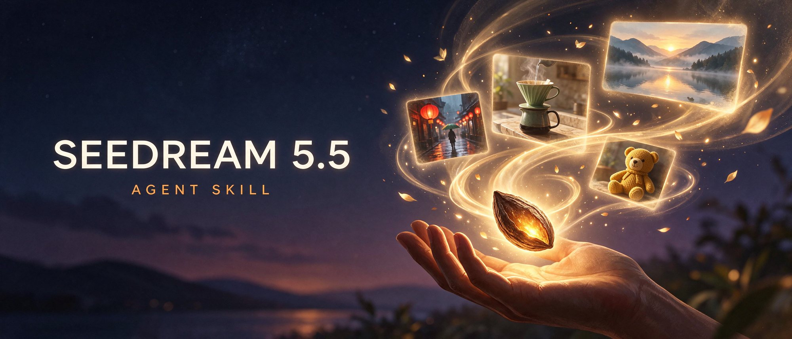

<sub><i>This banner, including its title text, was generated by Seedream 5.5 with this skill. So is every image on this page.</i></sub>

<br><br>


# Seedream Skill

**Your coding agent makes your project's images with Seedream: on-brand, the right sizes, in the right folders.**<br>
Works in Claude Code, Codex, Cursor, Gemini CLI, Copilot and about 70 more agents · Supports 9 API platforms · Every rule is tested and labelled

[](LICENSE)
[](https://agentskills.io/specification)


```bash
npx skills add mazen320/seedream-5-5-skill
```

**[For your project](#built-for-coding-agents)** · **[Gallery](#gallery)** · **[UI & layers](#ui-and-design-apps-websites-games-kiosks-events-layers)** · **[Tools](#finish-the-job-not-just-the-render)** · **[Prompt library](recipes/README.md)** · **[Platforms](#works-on-your-platform)** · **[Tested, not guessed](#tested-not-guessed)** · **[Use cases](#what-people-use-it-for)** · **[Install](#install)** · **[CLI](#use-the-script-directly)**

</div>

<br>

## Built for coding agents

Ask for "the images for my landing page" and get a finished kit in your repo, not one picture in a
temp folder:

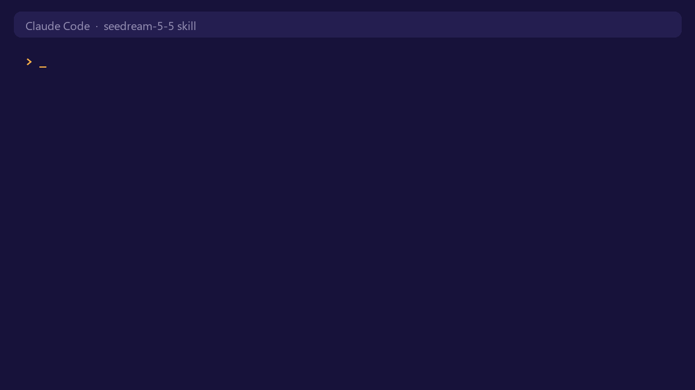

| Hero, 21:9 | Link preview, exact 1200×630 | Empty state + logo (transparent) | Favicon set |
|:-:|:-:|:-:|:-:|
|  |  | 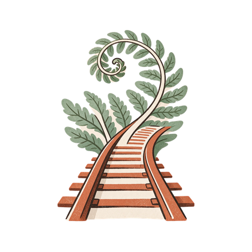 |   |

One style file and one manifest, then one approval. Four images in 31 seconds for about $0.14, plus
18 icon files and the `<head>` tags ([the full example](examples/04-project-asset-kit.md)).

```bash
python seedream.py batch .seedream/assets.json         # plan + estimated cost, spends nothing
python seedream.py batch .seedream/assets.json --yes   # generate in parallel; re-runs skip what's unchanged
python export.py icons public/images/logo.png --out public   # favicons, PWA, iOS, Android + <head> tags
python seedream.py costs --out .seedream              # what this project has spent
```

- 🎨 **Style lock:** `.seedream/style.md` goes on every prompt, so a whole site, app or game looks
  like one brand.
- 📋 **Batch manifests:** commit `.seedream/assets.json` with your code. Each run shows the plan and
  the cost before spending, runs in parallel, and only re-renders assets whose inputs changed,
  under the same file names (tested live: one prompt edit, "3 up to date, 1 to generate").
- 📐 **Exact sizes:** `--final-size 1200x630` and presets for OG, X cards, App Store, Play and Steam.
- 🧭 **Right folders:** the skill teaches the agent where Next.js, Hugo, Xcode, Android, Unity and
  Godot keep images, and how to wire them in.

<br>

## Gallery

Every image here is a first render, with no re-rolls or retouching. Click any image to see the
**exact prompt and parameters** that made it.

<table>
<tr>
<td width="50%" valign="top"><a href="assets/gallery/ceramicist.txt">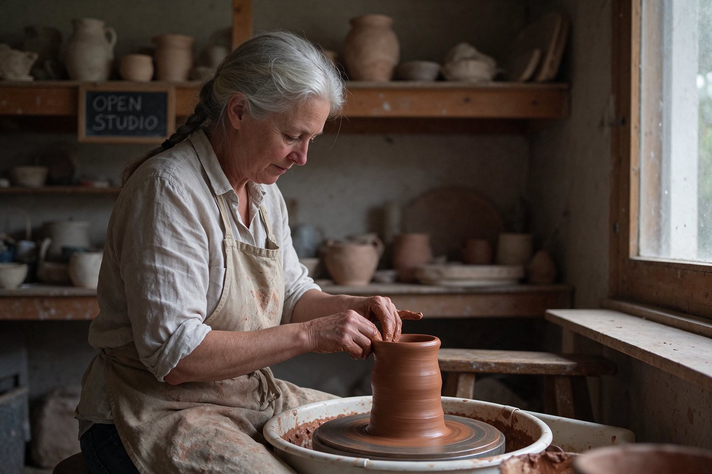</a><br><sub><b>Photoreal.</b> The lens, the light and the chalkboard text all come from one prose prompt.</sub></td>
<td width="50%" valign="top"><a href="assets/gallery/dripper.txt"></a><br><sub><b>Product.</b> Studio light, a travertine slab, and empty space left for copy. <i>(Cropped from 1:1.)</i></sub></td>
</tr>
</table>
<table>
<tr>
<td width="25%" valign="top"><a href="assets/gallery/poster.txt"></a><br><sub><b>Exact text.</b> Every word and number is exact.</sub></td>
<td width="25%" valign="top"><a href="evidence/img/c_chinese.txt">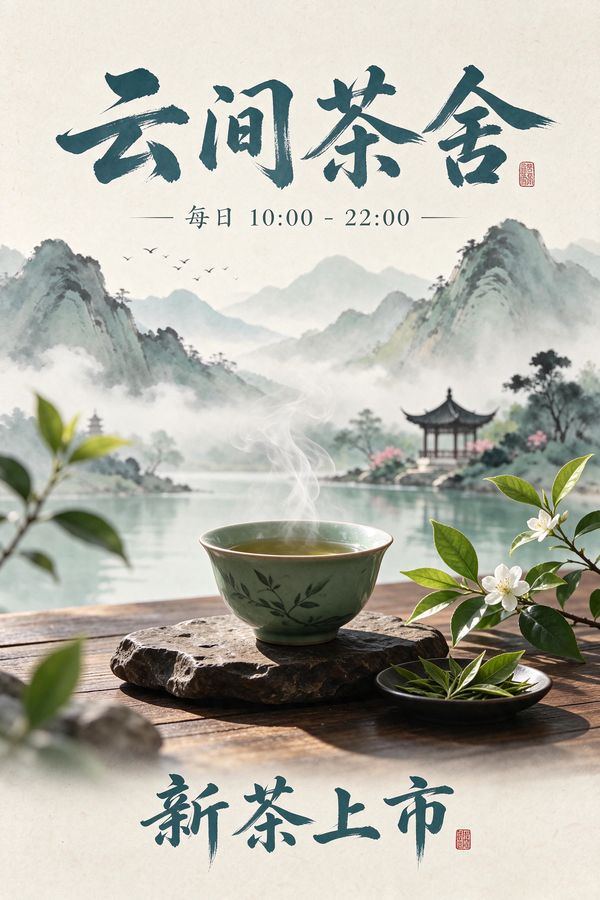</a><br><sub><b>Chinese text.</b> Calligraphy, written from a Chinese prompt.</sub></td>
<td width="25%" valign="top"><a href="assets/gallery/bramble_sheet.txt">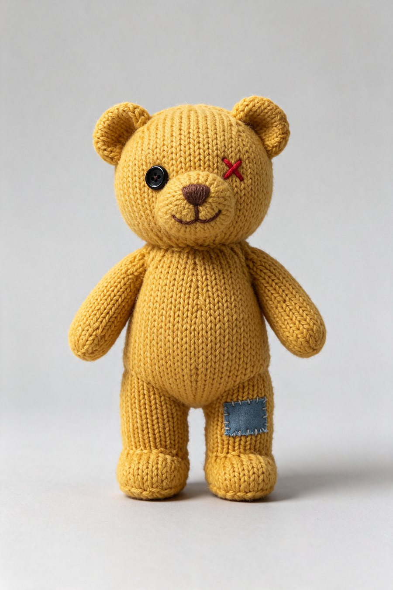</a><br><sub><b>Character sheet.</b> One eye stays one eye.</sub></td>
<td width="25%" valign="top"><a href="assets/gallery/transparent.txt"></a><br><sub><b>Transparent PNG.</b> True RGBA from <code>--background transparent</code>.</sub></td>
</tr>
</table>
<table>
<tr>
<td width="50%" valign="top"><a href="evidence/img/c_cafe.txt">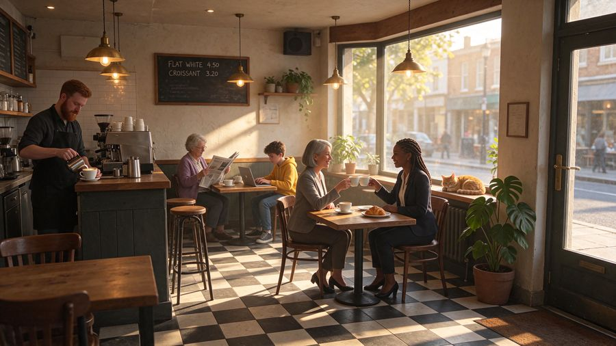</a><br><sub><b>Complex scene.</b> 5 described people, exact menu text, a cat and the right light direction, from one prompt. Not perfect: it added passers-by and two extra menus despite the exclusions.</sub></td>
<td width="50%" valign="top"><a href="evidence/img/c_infographic.txt"></a><br><sub><b>Infographic.</b> Every number and label is exact.</sub></td>
</tr>
</table>

### Consistent characters and one-change edits

| Two character sheets → one scene | "Change only one thing: add a red scarf" |
|:-:|:-:|
| [](assets/gallery/reading.txt) | [](assets/gallery/reading_scarf.txt) |
| Both identities stay separate. | Face, pose, room and light are unchanged. Two more rounds held too ([evidence](evidence/README.md)). |

### Hard tasks: precision edits and print-grade layouts

| Original | "Swap the croissant for cake, rewrite the chalkboard, remove the cat. Change nothing else." |
|:-:|:-:|
| [](evidence/img/r2_cafe_original.jpg) | [](evidence/img/r2_cafe_edit.txt) |
| | All three changes exact in one render. `export.py merge` then kept the other 93% of pixels identical to the original. |

<table>
<tr>
<td width="33%" valign="top"><a href="evidence/img/r2_cover.txt"></a><br><sub><b>Magazine cover.</b> Masthead, a pull quote and 3 cover lines, all exact.</sub></td>
<td width="33%" valign="top"><a href="evidence/img/r2_ad.txt">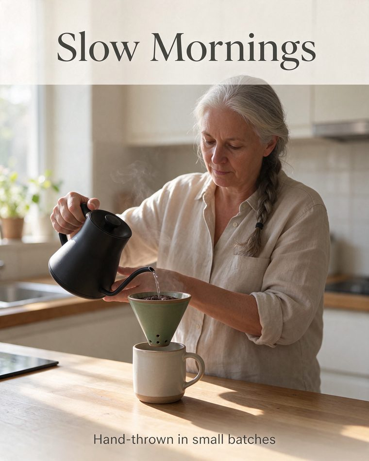</a><br><sub><b>Ad from 2 references.</b> The product from one photo, the woman from another, plus exact copy.</sub></td>
<td width="33%" valign="top"><a href="evidence/img/r2_chain3.txt"></a><br><sub><b>3-step edit chain.</b> Snow, then a beanie, then cocoa. The characters held through all 3 steps.</sub></td>
</tr>
</table>

### Edit anything: restore, relight, swap, draw-to-edit, outpaint

| Restore + colourise an old photo | Draw a circle: "add a kitten here, then remove the marks" |
|:-:|:-:|
| [](evidence/img/r6_restore.txt) | [](evidence/img/r6_markup.txt) |
| **Swap the background, keep the product** | **Extend a poster to 16:9** (padded canvas, then fill) |
| [](evidence/img/r6_bg.txt) | [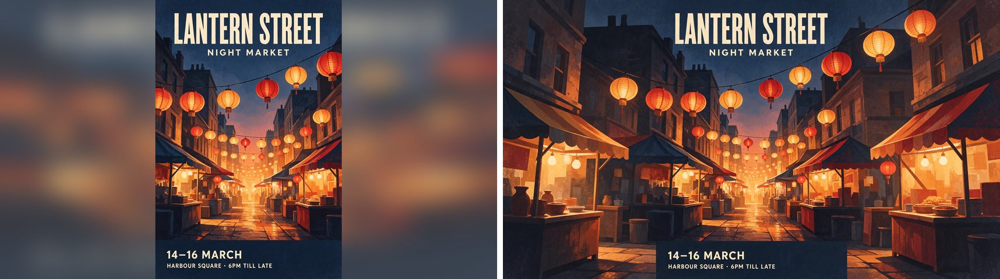](evidence/img/r6_outpaint3.txt) |

9 tested edit types, with the prompt formula and the one that fails (see the
[editing playbook](skills/seedream-5-5/references/editing.md)).

### UI and design: apps, websites, games, kiosks, events, layers

<table>
<tr>
<td width="22%" valign="top"><a href="evidence/img/r3_ui_app.txt"></a><br><sub><b>App screen.</b> 20 labels, all exact.</sub></td>
<td width="22%" valign="top"><a href="evidence/img/r3_ui_dark.txt">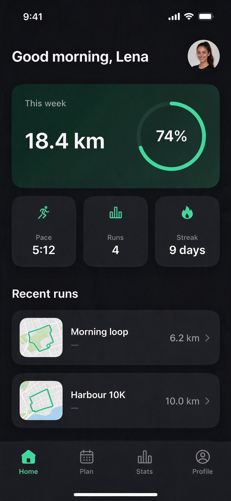</a><br><sub><b>Dark mode</b> from the light screen. Nothing moved.</sub></td>
<td width="56%" valign="top"><a href="evidence/img/r3_web_landing.txt">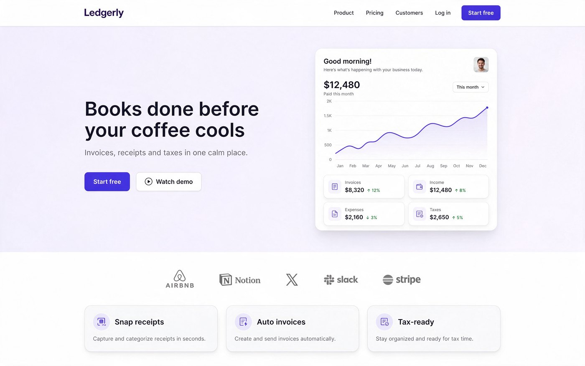</a><br><sub><b>Landing page.</b> Every quoted word exact, but "placeholder logos" came back as <b>real brands</b>. The skill now warns about this and words around it.</sub><br><br><a href="evidence/img/r3_ui_mockup.txt"></a><br><sub><b>Marketing mockup</b> made from the screenshot.</sub></td>
</tr>
</table>

<table>
<tr>
<td width="50%" valign="top"><a href="evidence/img/r3_game_hud.txt">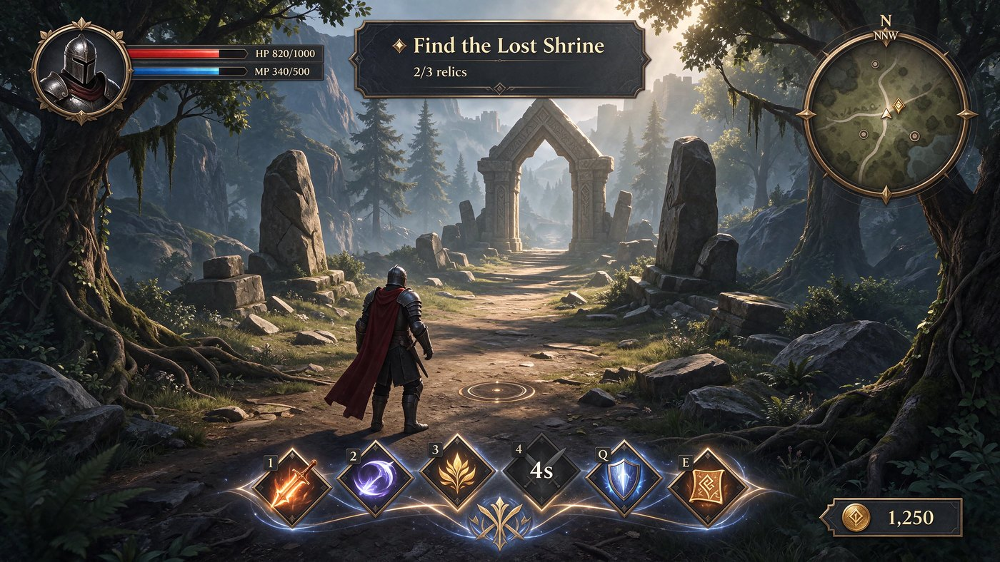</a><br><sub><b>Game HUD.</b> HP/MP bars, quest tracker, minimap, 6 ability slots with keybinds and a cooldown. Every label exact.</sub></td>
<td width="18%" valign="top"><a href="evidence/img/r3_kiosk.txt"></a><br><sub><b>Kiosk.</b> Prices, tabs and checkout, all exact.</sub></td>
<td width="18%" valign="top"><a href="evidence/img/r3_event_badge.txt"></a><br><sub><b>Event badge</b> with a QR placeholder.</sub></td>
</tr>
<tr><td colspan="3"><a href="evidence/img/r3_event_stage.txt"></a><br><sub><b>32:9 stage LED wall</b> at 3584×1008, made in one render.</sub></td></tr>
</table>

| One flat poster → editable layers (`--layers 12 --ocr`) | One render → 9 icon files (`export.py split`) |
|:-:|:-:|
| 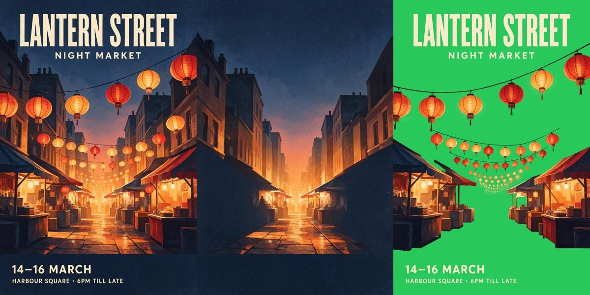 | <br> |
| Original · clean base plate · the 10 layers above the base plate, on green. Text layers come back with exact OCR, a font guess and a colour. `export.py layers` writes an SVG with one image per layer, for design tools such as Figma. | One consistent style, one billed image, nine trimmed transparent PNGs. |

<br>

## Finish the job, not just the render

| | |
|---|---|
| 🎲 **Options** | `--count 4` renders 4 versions in parallel and writes an HTML contact sheet to pick from |
| 🧼 **Clean edits** | Seedream redraws the whole frame on every edit. `export.py merge original edited` keeps only the regions that really changed, so everything else stays pixel-perfect |
| 📐 **Platform export** | `export.py --to instagram-post --to story` crops or pads to 12 presets: Instagram, Stories/Reels, YouTube, X, LinkedIn, Pinterest, A4/A5 print. It warns when the crop would cut a lot |
| 🧅 **Layers** | `--layers N --ocr` splits a flat image into named, positioned layers. You get an interactive layer viewer, `layers.json` (boxes, text, font guesses), an SVG for Figma or Illustrator (with `--live-text`, text layers become editable text), and aligned PNGs for Photoshop or After Effects |
| ✂️ **Split** | `export.py split sheet.png` cuts a transparent sheet of icons, stickers or sprites into one trimmed PNG per item, named and in reading order |
| 🪞 **Mirror fix** | `export.py --flip` corrects a one-sided detail that landed on the wrong side |
| 📋 **Batch + style lock** | `seedream.py batch` turns a manifest into a consistent set. It estimates the cost first and skips unchanged assets |
| 🎨 **Match your brand** | `export.py style logo.png screenshot.png` pulls your real palette into `.seedream/style.md`, so new images match what you already have |
| 🏷️ **Icons** | `export.py icons` turns one logo into favicons, PWA, iOS `AppIcon.appiconset` and Android mipmaps, plus the HTML tags |
| 💸 **Cost ledger** | Every paid call is logged next to the images; `seedream.py costs` sums it up |
| 📚 **Prompt library** | [31 copy-paste prompts](recipes/README.md), each shown with the exact image it produced |

<br>

## Works on your platform

Seedream is sold through many APIs, each with its own field names, size formats and async
flow. The skill's script hides those differences: you pick `--provider`, and it handles the
rest.

| Platform | `--provider` | Key variable | Seedream |
|---|---|---|---|
| **BytePlus ModelArk** | `byteplus` (default) | `ARK_API_KEY` | **5.5** ✅ live-tested |
| **Volcengine Ark** (China) | `volcengine` | `ARK_API_KEY` | **5.5** |
| **Runware** | `runware` | `RUNWARE_API_KEY` | **5.5** |
| **WaveSpeedAI** | `wavespeed` | `WAVESPEED_API_KEY` | **5.5** |
| **Kie.ai** | `kie` | `KIE_API_KEY` | **5.5** |
| **Evolink** | `evolink` | `EVOLINK_API_KEY` | **5.5** |
| **fal** | `fal` | `FAL_KEY` | **5.5** (incl. layers) |
| **Replicate** | `replicate` | `REPLICATE_API_TOKEN` | 5.0 Pro |
| **OpenRouter** | `openrouter` | `OPENROUTER_API_KEY` | **5.5** |

BytePlus is tested against the live API. The other eight follow their published docs and are
covered by offline mock tests of each platform's full flow, including async polling. If you use
one of them, please [open an issue](../../issues) with how it went.

The prompting guidance in the skill works on any platform, including ones the script doesn't
support. Endpoints, fields and prices are in
[`providers.md`](skills/seedream-5-5/references/providers.md).

<br>

## Tested, not guessed

Most prompt guides repeat folklore. We ran 44 test renders, 2 layer splits, 2 size-limit checks and
four rounds of with-skill vs without-skill tests on Seedream 5.5 to check our own rules. **Several common beliefs turned out to be wrong, and the skill was corrected to match.**

| Common belief | What happened when we tested it |
|---|---|
| "Name the side and a one-sided detail lands there" | ⚠️ Only 3 times in 6 (eyepatch, earring, antenna, button eye). Layout positions like "on the image-left" held every time. The skill now says: state it both ways, check it, and mirror-flip if it's wrong |
| "More than 2 people causes identity bleed" | ❌ 3 people from 3 reference images, and 5 people in a café, all stayed distinct |
| "Rows of identical objects drift" | ⚠️ A row of 12 was perfect. In a busy 3×3 grid the **count** held but the **sameness** didn't |
| "Avoid negatives like *no people*" | ❌ Negatives were obeyed. In busy scenes, though, excluded things leak in at the edges |
| "Keep prompts short" | ❌ A 230-word prompt followed nearly every detail; a 60-word one made things up |
| "Edits drift after a few rounds" | ✅ Not in our test: 3 rounds, and the face stayed the same |
| "Ask for placeholder logos" | ⚠️ We got real Airbnb, Slack and Stripe logos on a mockup. Ask for plain grey shapes instead |
| "Draft at 1K, it's faster" | ⚠️ Only 3 s faster (24 s vs 27 s over 3 runs each). It is cheaper, though ($0.020 vs $0.035) |
| "Layer decomposition gives clean cut-outs" | ⚠️ Mostly. Re-stacking matched the original, but some edges are hard-clipped and glows carry haze. The skill shows how to check and clean them |
| Size limits | ✅ Confirmed by the API: 921,600 to **4,624,220** px |

We also ran Anthropic's [skill-creator](https://github.com/anthropics/skills) eval loop: 13 real
tasks, each run by an agent **with** the skill and an agent **without** it, both on Seedream 5.5,
graded on the same checklist.

| Latest run of each of the 13 tasks | With skill | Without skill |
|---|---|---|
| Checks passed | **83 / 83** | 81 / 83 |
| Invented text (a fake seal, a fake barcode) | **none** | 2 |
| Platform facts correct (e.g. which version fal hosts) | ✅ | ✅ |
| Native transparent icons, first try | ✅ | ❌ It didn't know 5.5 can output transparency, so it keyed out a magenta background and needed a second render |

Tasks: a transparent sticker, a Chinese poster, a storyboard, a precision edit, an edit chain, a
2-reference ad, a magazine cover, a website hero, dark mode plus a Figma hand-off, game icons, one
image in 3 social sizes, a fal request (dry run), and a translated poster.

A strong agent with no skill already gets most single images right. The skill adds what an agent
can't improvise: current platform facts, the failure modes we measured, and the project-asset
pipeline (style lock, batches, exact sizes, icon sets, cost control).

Every rule in the skill is labelled **Tested**, **Official** or **Reported**. All images and
prompts are in the [evidence log](evidence/README.md). Each test is a single render, so treat
the results as spot checks, not benchmarks.

<br>

## What people use it for

The skill includes playbooks for the 12 jobs people use Seedream for most, based on public
reviews and our own tests:

| | | |
|---|---|---|
| 👗 Realistic people and fashion | 🛍️ E-commerce and ads | 🪧 Posters and Chinese text |
| 📊 Infographics and slides | 🧸 Consistent characters and storyboards | ✏️ Editing by instruction and region edits |
| 🎬 Keyframes for Seedance and Kling | 🧩 Transparent assets, icon sets and layers | 📱 UI: apps, websites, dashboards, game HUDs, kiosks |
| 🌍 Localising a design into other languages | ⚡ Speed, cost and live apps | 🎤 Events: stage screens, badges, signage |

The playbooks also cover version choice: 5.5 for edits and transparency, 4.5 or 5.0 Lite when
you need 4K or an image set in one call. They also cover rewording prompts that the safety
filter rejects by mistake, and avoiding unwanted square outputs. See
[`use-cases.md`](skills/seedream-5-5/references/use-cases.md) and, for screens,
[`ui-ux.md`](skills/seedream-5-5/references/ui-ux.md).

<br>

## How it prompts

You describe what you want in plain words. The agent turns that into a structured prose prompt.
This is the prompt behind the ceramicist image above:


The agent then:
1. Picks a **mode**: generate, edit, multi-reference, region edit with `<bbox>`, or transparent.
2. Gives every reference image a **role**.
3. Runs **pre-flight checks** against the known failure modes.
4. **Renders the image** and saves a sidecar `.txt` file with the exact prompt and parameters.
5. **Reviews the result against your brief** and fixes one thing per round.

<br>

## Install

<table>
<tr><th>Agent</th><th>How</th></tr>
<tr><td><b>Any agent</b></td><td><code>npx skills add mazen320/seedream-5-5-skill</code> (<a href="https://github.com/vercel-labs/skills">skills CLI</a>)</td></tr>
<tr><td><b>Claude Code</b></td><td><code>/plugin marketplace add mazen320/seedream-5-5-skill</code>, then <code>/plugin install seedream-5-5</code>. Adds <code>/seedream</code>, <code>/seedream-kit</code>, <code>/seedream-edit</code> and <code>/seedream-icons</code></td></tr>
<tr><td><b>Codex</b></td><td>Copy <code>skills/seedream-5-5/</code> to <code>~/.agents/skills/</code></td></tr>
<tr><td><b>Cursor</b></td><td>Copy it to <code>~/.cursor/skills/</code> or <code>.agents/skills/</code></td></tr>
<tr><td><b>Gemini CLI</b></td><td><code>gemini skills install https://github.com/mazen320/seedream-5-5-skill --path skills/seedream-5-5</code></td></tr>
<tr><td><b>Copilot</b></td><td>Copy it to <code>~/.copilot/skills/</code> or <code>.github/skills/</code></td></tr>
</table>

Next, set the key for your platform in the shell your agent runs in. For example:

```bash
export ARK_API_KEY=...            # PowerShell: $env:ARK_API_KEY = '...'
```

> [!IMPORTANT]
> Never paste a key into the chat. The skill tells the agent never to ask for one. The script
> reads keys only from environment variables, never sends them to image CDNs, and never writes
> them to disk.

<br>

## Use the script directly

<details>
<summary><b>CLI reference</b></summary>

<br>

```bash
S=skills/seedream-5-5/scripts/seedream.py
python $S providers                                     # platforms and key variables
python $S models                                        # Seedream model IDs (byteplus/volcengine)
python $S generate --prompt "..." --size 16:9 --out out --name hero
python $S generate --provider fal --prompt-file p.txt --image a.png --image b.jpg --size 2:3
python $S generate --prompt "..." --size 1:1 --background transparent
python $S generate --prompt "..." --dry-run              # print the request; no key, no cost
python $S generate --image screen.png --layers 15 --ocr --prompt "Split into UI layers. Name every layer in English."
```

| Flag | Meaning |
|---|---|
| `--provider` | One of the 9 platforms above (or set `SEEDREAM_PROVIDER`) |
| `--size` | Ratio: `1:1` `4:3` `3:4` `16:9` `9:16` `3:2` `2:3` `21:9`; tier: `1K` `1.5K` `2K`; or `WxH` from 921,600 to 4,624,220 px |
| `--image` | A path, URL or data URI. Repeat for up to 10; they become Image 1, Image 2 and so on |
| `--background` | `transparent` gives an RGBA PNG on 5.5 |
| `--model` | Overrides the platform's default Seedream model |
| `--extra` | A JSON object merged into the request, for platform-specific fields such as image sets |
| `--name` | File stem. `_2`, `_3` and so on are added rather than overwriting |
| `--count` | Render N options in parallel (max 8) and write an HTML contact sheet |
| `--style FILE` | Append a project style file to the prompt, for a consistent look |
| `--final-size WxH` / `--fit` | Also save an exact-size copy (crop or pad), e.g. `1200x630` |
| `batch MANIFEST` | Generate a whole asset list; `--yes` to spend, `--only`, `--force`, `--jobs` |
| `costs --out DIR` | Sum the cost ledger for a folder |
| `--layers N` / `--ocr` | Split the one `--image` into up to N layers (5.5, BytePlus or Volcengine), with text, font and colour for text layers. Every layer is billed |

</details>

<details>
<summary><b>What's in the repo</b></summary>

<br>

```
skills/seedream-5-5/
├── SKILL.md                  core rules, platform picker, modes, prompt structure, pre-flight
├── scripts/seedream.py       9 providers · generate (--count, --layers, --style, --final-size) · batch · costs · --dry-run
├── scripts/export.py         merge · layers · split · icons · 20 size presets · pad/crop · --flip (needs Pillow)
├── evals/                    skill-creator test cases (with vs without skill)
└── references/
    ├── prompting.md          14 templates (tested ones marked)
    ├── failure-modes.md      22 failure modes, each labelled Tested / Official / Reported
    ├── use-cases.md          12 playbooks and a model picker
    ├── ui-ux.md              apps, websites, dashboards, games, kiosks, dark mode, mockups, icons, Figma hand-off
    ├── project-assets.md     style lock, batch manifests, exact sizes, icon sets, where each framework keeps images
    ├── editing.md            9 tested edit types: swap, relight, restore, remove, restyle, sketch, outpaint, draw-to-edit
    └── providers.md          versions, IDs, fields, prices, error codes
commands/                     /seedream, /seedream-kit, /seedream-edit, /seedream-icons (Claude Code)
recipes/                      31 copy-paste prompts, each with the image it produced
evidence/                     every test render with its prompt, and what it proved
examples/                     4 worked examples with real results (incl. a full website asset kit)
tests/                        offline mock tests of all 9 providers
```

</details>

<br>

## Contributing

The most valuable contributions are:
- a **live report from a platform** other than BytePlus;
- a **re-run of a test** in the [evidence log](evidence/README.md) that came out differently;
- a **new failure mode, with a tested fix**.

Please include the prompt and the sidecar `.txt`.

```bash
python -m unittest discover -s tests -v
```

<br>

<div align="center">


If this skill saved you a render, **[give it a ⭐](https://github.com/mazen320/seedream-5-5-skill)**.

<sub>MIT licensed. Not affiliated with ByteDance, BytePlus or any of the platforms listed. Model IDs, limits and prices change.<br>
Part of the prompt structure is adapted from the Seedream 5.5 guide in <a href="https://github.com/Evolink-AI/awesome-seedream-5-5-guide-and-prompt">Evolink-AI/awesome-seedream-5-5-guide-and-prompt</a> (CC BY 4.0).</sub>

</div>
