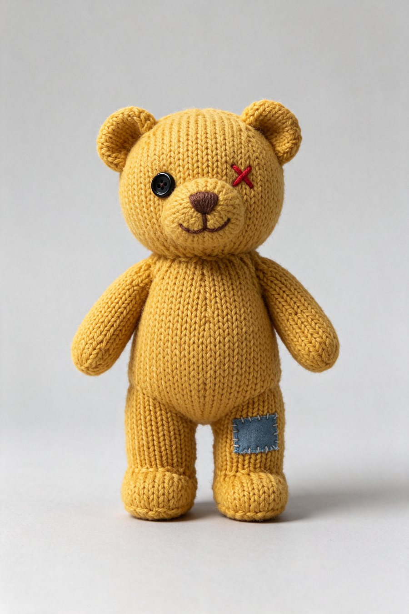
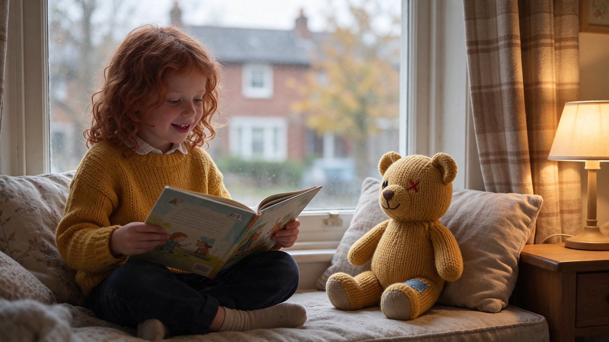
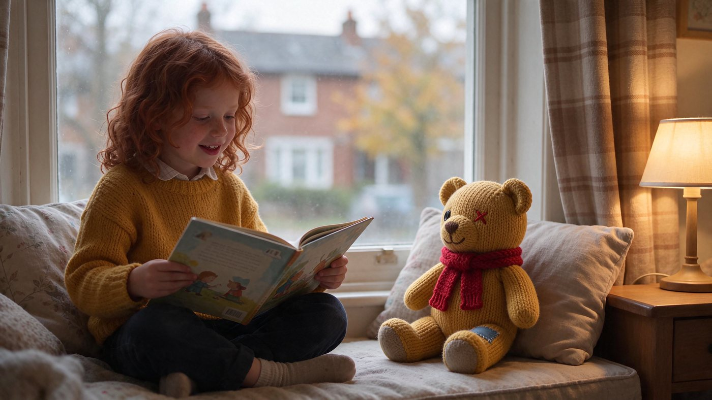

# Example 3: a consistent character across scenes and edits

**Ask:** "I need a mascot, a one-eyed knitted bear called Bramble. Show it with a kid
reading, and then a version where it wears a scarf."

**Mode:** a character sheet, then a two-reference scene, then a multi-round edit. Two
things to manage: an asymmetric detail (one eye, and which side it lands on), and drift across
edits.

## 1. Character sheet (`bramble.txt`)

```text
A full-body character reference of Bramble, a hand-knitted toy bear about 30 cm tall in chunky
mustard-yellow wool with visible stitches, short rounded ears and a slightly lopsided smile in
brown thread. Bramble has exactly one eye: a single shiny black button on the toy's left side of
the face; on the right side, where the second eye would be, there is a small stitched X in red
thread. A faded blue patch is sewn onto the left knee. Neutral standing pose, arms slightly away
from the body, facing the camera, whole figure visible with space around it. Plain light-grey
seamless backdrop, soft even studio light, sharp focus throughout.
Exclusions: no second eye, no props, no other characters, no text.
```

```bash
python skills/seedream-5-5/scripts/seedream.py generate --prompt-file bramble.txt --size 2:3 --out out --name bramble_sheet
```

Make a character sheet for the child (`mila_sheet.png`) the same way.

## 2. The scene (`reading.txt`)

```text
A warm photorealistic image. Image 1 provides Bramble the knitted bear: keep the single button
eye on the toy's left, the red stitched X on the right, the mustard wool and the blue knee patch
exactly. Image 2 provides Mila, the child: keep her face, curly auburn hair and yellow jumper
exactly. Mila sits on the left of frame on a window seat, reading a picture book aloud; Bramble
sits on the right of frame propped against a cushion, facing her. Soft grey daylight from the
window behind them, warm lamp glow from the right. Medium shot at eye level on a 40mm lens,
gentle depth of field.
Exclusions: no other people, no readable text on the book, no second eye on the bear.
```

```bash
python skills/seedream-5-5/scripts/seedream.py generate --prompt-file reading.txt --image out/bramble_sheet.png --image out/mila_sheet.png --size 16:9 --out out --name reading
```

## 3. The edit (`scarf.txt`)

```text
Image 1 is the current image. Change only one thing: Bramble now wears a tiny red knitted scarf
wrapped once around the neck, its ends hanging over the chest. Keep everything else exactly as in
Image 1: Mila's face, hair, jumper and pose, Bramble's single button eye and red stitched X exactly where
they are in Image 1, the window seat, the lighting and the framing. Image 2 is Bramble's
identity reference only.
Exclusions: no other changes, no second eye on the bear, no text.
```

```bash
python skills/seedream-5-5/scripts/seedream.py generate --prompt-file scarf.txt --image out/reading.png --image out/bramble_sheet.png --size 16:9 --out out --name reading_scarf
```

## What actually happened

| Character sheet | Scene (two references) | Edit: + scarf |
|:-:|:-:|:-:|
|  |  |  |

- The one-eye asymmetry held in all three images, and the scene kept both identities apart.
- The edit changed only the scarf. Face, pose, room, light and framing stayed the same.
- **One miss, and it taught us something.** The sheet put the button eye on the *viewer's* left
  even though the prompt said "the toy's left". The knee patch in the same prompt did land on
  the toy's own left. Follow-up tests found the same pattern: one-sided details on a face or
  body came out mirrored in 3 of 4 tries, while layout positions ("on the image-left of the
  frame") held. So the edit prompt said "exactly where they are in Image 1" instead of naming a
  side, and the skill now says: check small one-sided details, and mirror-flip the image if the
  side is wrong. See [`evidence/`](../evidence/README.md).

The exact prompts and parameters are in the sidecars in [`assets/gallery/`](../assets/gallery/).

## Why it works

- The asymmetry is stated in three places: on the character sheet, in every later prompt, and
  in the exclusions ("exactly one button eye … no second eye"). That holds the **count**. The
  **side** comes from the reference image, not from the wording.
- Each person has their own reference and a screen position. Our tests kept up to 5 people
  distinct, so this is good practice rather than a hard limit.
- The edit makes one change, repeats the full keep-list, and re-attaches the original sheet
  as an identity reference.
- The sidecars `reading.txt` and `reading_scarf.txt` record which file was Image 1 and which
  was Image 2, with SHA-256 hashes. You can audit your own chain the same way. The full-size
  originals behind our hashes are not in the repo, only web-sized copies.
