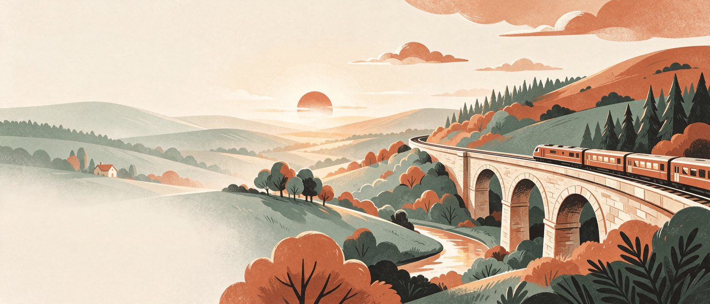
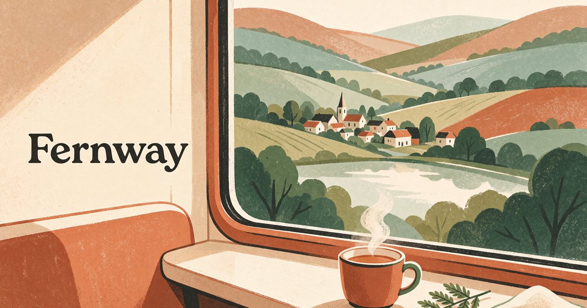
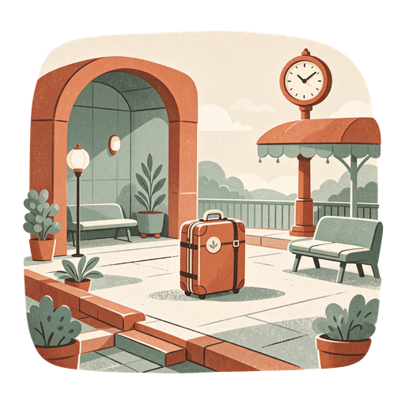
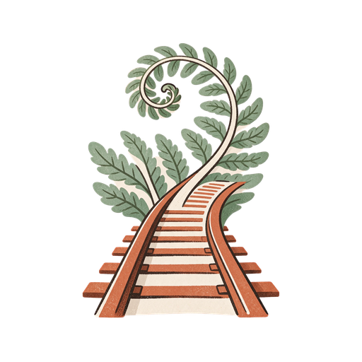
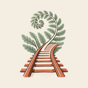
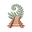

# Example 4: a website's whole image kit from one manifest

**Ask:** "I'm building the landing page for Fernway, an app for slow train trips. I need a hero, a
link-preview image, an empty-state illustration for the trips list, and a logo mark plus all the
favicons. Make them feel like one brand."

**Approach:** one style file, one manifest, one approval, one batch, then the icon export. This
is a real run on Seedream 5.5 (November 2026): 4 images, about $0.14, 31 seconds in parallel. Both
files live in `.seedream/`; paths inside the manifest are relative to the project root.

## `.seedream/style.md`

```text
Warm editorial illustration: soft risograph grain, a limited palette of terracotta #D9734E, sage
#9DB39A, cream #F4EDE1 and ink #23201C, simple rounded shapes, gentle hand-drawn outlines,
generous negative space, no gradients, no photorealism.
```

## `.seedream/assets.json`

```json
{
  "provider": "byteplus",
  "out": "public/images",
  "style_file": ".seedream/style.md",
  "defaults": {"size": "16:9"},
  "assets": [
    {"name": "hero", "size": "21:9",
     "prompt": "Website hero illustration for 'Fernway', an app for planning slow-travel train trips: a small train crossing a curved viaduct through rolling hills at golden hour, with empty space on the left third for a headline. No text."},
    {"name": "og-image", "size": "2K", "final_size": "1200x630",
     "prompt": "Link-preview card for 'Fernway': a train window framing hills and a tiny village, a cup of tea on the sill. The word \"Fernway\" in a friendly rounded serif on the left. Nothing else is written."},
    {"name": "empty-trips", "size": "1:1", "background": "transparent",
     "prompt": "Empty-state illustration for a list with no trips yet: a single suitcase on a quiet station platform with a bench and a clock. No text. Set a transparent background."},
    {"name": "logo-mark", "size": "1:1", "background": "transparent",
     "prompt": "App icon mark for 'Fernway': a fern leaf curling into the shape of a railway track, centred, bold and simple, readable at 32 px. No text. Set a transparent background."}
  ]
}
```

## Run it

```bash
S=skills/seedream-5-5/scripts
python $S/seedream.py batch .seedream/assets.json          # plan: 4 images, ~$0.14, nothing spent
python $S/seedream.py batch .seedream/assets.json --yes    # generate
python $S/seedream.py batch .seedream/assets.json --yes    # re-run: "4 up to date", nothing spent
python $S/seedream.py costs --out .seedream                # ~$0.14
python $S/export.py icons public/images/logo-mark.png --out public --bg "#F4EDE1" --name Fernway
```

## Result

| Hero (21:9) | Link preview (exact 1200×630) |
|:-:|:-:|
| [](../evidence/img/r5_hero.txt) | [](../evidence/img/r5_og-image.txt) |

| Empty state (transparent) | Logo mark (transparent) | apple-touch-icon | favicon 32 px |
|:-:|:-:|:-:|:-:|
| [](../evidence/img/r5_empty-trips.txt) | [](../evidence/img/r5_logo-mark.txt) |  |  |

**What held:** all four images share the palette, grain and line style; the hero kept the left
third clear; "Fernway" is spelled right on the card, and the crop to 1200×630 kept it; both
transparent assets are real RGBA.

**What to fix:** the logo mark is too detailed for a 32 px favicon. For the favicon, a second,
simpler mark ("one bold shape, two colours, no fine detail") would read better. The empty state
came back as a scene inside a rounded tile rather than a free-floating object. We changed its
prompt to "a single small suitcase standing alone, with a folded paper map leaning against it; a
single object, no background tile, no scene" and re-ran the batch: "3 up to date, 1 to generate",
same file name, and the new one floats ([image](../evidence/img/r5_empty-trips_v2.png)).

**Then wire it in:** copy the icon files to `public/`, paste `head-snippet.html` into the layout's
`<head>`, add `<meta property="og:image" content="/images/og-image_1200x630.png">`, and use
`hero.png` and `empty-trips.png` with real alt text.
