# Prompt library

Copy-paste prompts that produced the image shown next to them on **Seedream 5.5**. Every prompt is
extracted from the generation's sidecar record, so it is exactly what was sent, not a retyped
approximation. Click an image for the full record (parameters, references, response).

Swap in your own subject and keep the structure. That structure is what makes them work. The
reasoning behind each pattern is in [`prompting.md`](../skills/seedream-5-5/references/prompting.md).

```bash
S=skills/seedream-5-5/scripts/seedream.py     # add --provider <name> for other platforms
```

**Jump to:** [Photoreal](#photoreal) · [Product](#product) · [Text & design](#text--design) · [Characters](#characters) · [Editing](#editing) · [UI & web](#ui--web) · [Games & events](#games--events) · [Assets](#assets)

## Photoreal

### Documentary portrait with in-scene text

<a href="../assets/gallery/ceramicist.txt">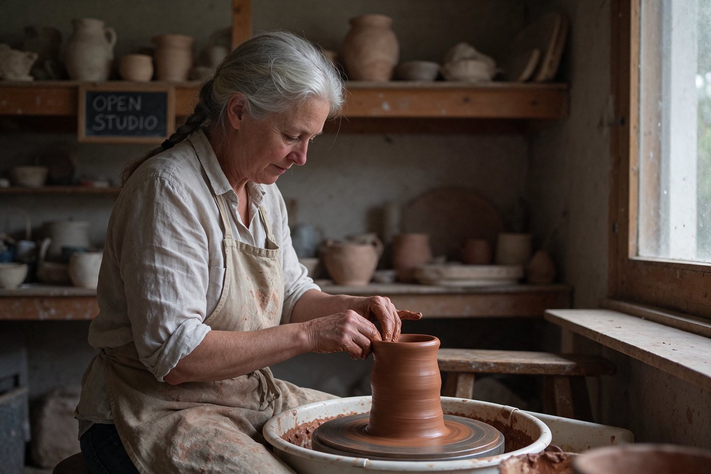</a>

Names a real light source, lens and grain to avoid the plastic AI look. The chalkboard text came out exact.

```text
A photorealistic medium shot of a ceramicist in her sixties with a silver braid and a clay-streaked apron, seated at a potter's wheel on the left third of the frame, shelves of bisque pots behind her. Wet terracotta clay rising under her hands, a worn oak bench, linen sleeves rolled to the elbow. Soft north-window light from the right, cool 5600K, gentle falloff into shadow. Shot on a 50mm lens at f/2.8, background softly blurred. Muted earthy palette, fine film grain, calm documentary mood. A small chalkboard on the shelf reads "OPEN STUDIO".
Exclusions: no extra people, no logos, no watermark, no other text.
```

```bash
python $S generate --size 3:2 --prompt-file prompt.txt --name documentary_portrait_with_in_scene_text
```
<br clear="right">

### Busy scene with five people

<a href="../evidence/img/c_cafe.txt">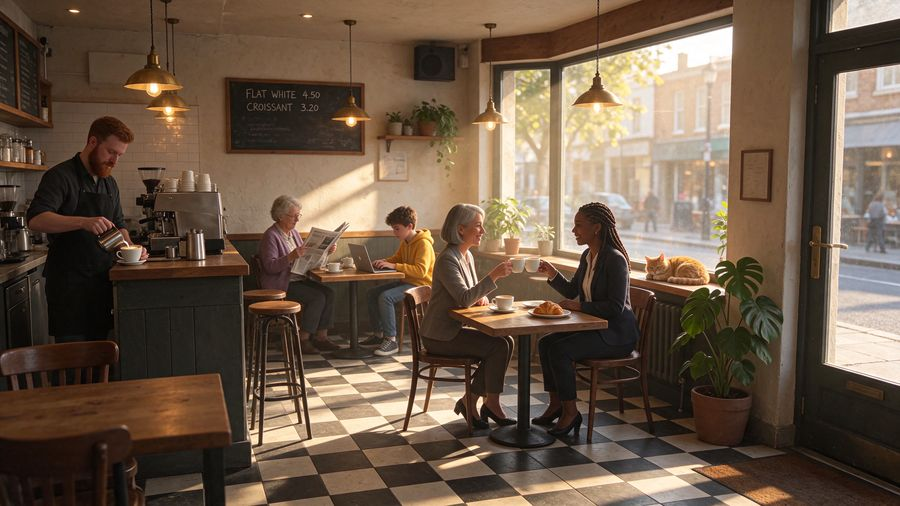</a>

Gives each person a place and an action. Exclusions leaked here (passers-by, extra menus), so expect a clean-up pass.

```text
A photorealistic wide shot inside a busy corner café at golden hour. Five clearly different people: at the counter on the image-left, a tall barista with a red beard and a black apron pours latte art; at the window table, an elderly woman in a lilac cardigan reads a newspaper; beside her, a teenage boy in a yellow hoodie types on a silver laptop; at the centre table, two women in business suits, one with a grey bob and one with long braids, clink white coffee cups. On the centre table there are exactly three white cups and one croissant on a plate. A chalkboard menu on the back wall reads "FLAT WHITE 4.50" on the first line and "CROISSANT 3.20" on the second line. A ginger cat sleeps on the windowsill. Warm sunlight streams through the windows from the image-right, casting long shadows across a black-and-white checkered floor. Hanging brass pendant lamps, potted monstera by the door. Shot on a 24mm lens at eye level, everything in focus. Exclusions: no other people, no other text.
```

```bash
python $S generate --size 16:9 --prompt-file prompt.txt --name busy_scene_with_five_people
```
<br clear="right">

### Editorial chef: a long prompt is detail control

<a href="../evidence/img/c_long.txt">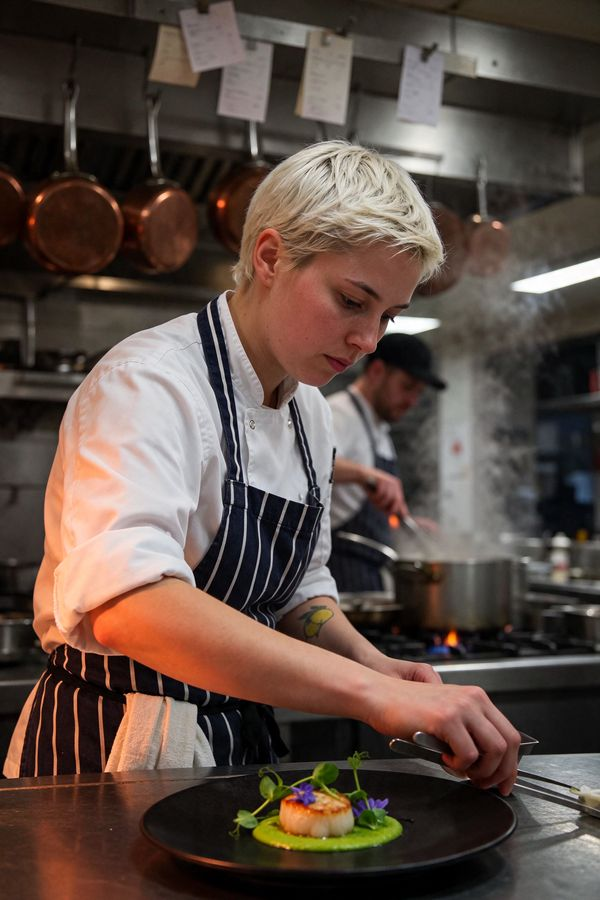</a>

Around 230 words, and almost every detail followed. A 60-word version invented its own wardrobe.

```text
An editorial magazine photograph, vertical, of a young chef in her late twenties standing in a narrow professional kitchen during evening service. She has a short platinum pixie cut, a small tattoo of a lemon on her inner left forearm, rolled white chef's jacket sleeves, a navy striped apron and a white towel tucked into the apron string. She is plating a dish with tweezers: a single seared scallop on a pool of bright green pea purée, three pea shoots and two edible violet flowers, on a matte black ceramic plate. Behind her, slightly out of focus, copper pans hang from a steel rail, a sous chef in a black cap stirs a large pot releasing visible steam, and order tickets are clipped to a steel rail above the pass. The light is mixed: cool fluorescent from above and a warm orange glow from the flames of a gas burner on the image-left. Her expression is focused, lips slightly pressed, eyes on the plate. Shot on an 85mm lens at f/2, shallow depth of field, the plate and her hands tack-sharp. Rich colour, slight film grain, high contrast. Exclusions: no readable text on tickets, no logos, no third person.
```

```bash
python $S generate --size 2:3 --prompt-file prompt.txt --name editorial_chef_a_long_prompt_is_detail_c
```
<br clear="right">

### Cinematic night street

<a href="../evidence/img/prose.txt">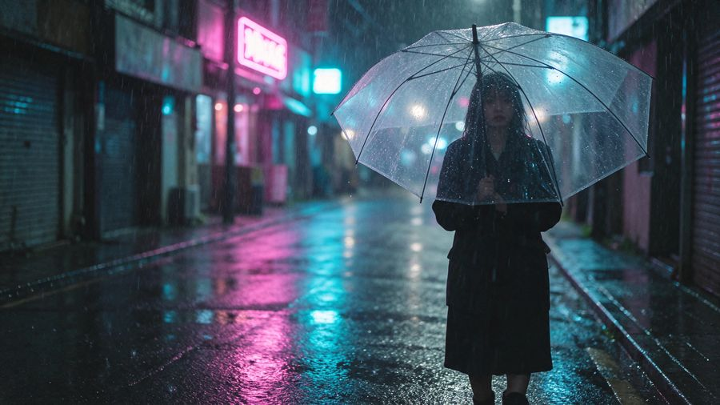</a>

Prose with a placement ("image-right third") and a lens. Compare with the tag-list version in the evidence log.

```text
A cinematic photograph of a woman holding a clear umbrella on a narrow street at night in heavy rain, framed on the image-right third, walking toward camera. Pink and cyan neon signs glow above shuttered shops and reflect in the wet asphalt. Shot on a 35mm lens at f/1.8, the background melting into soft bokeh. Cool palette with saturated neon accents, fine grain. Exclusions: no readable text on signs.
```

```bash
python $S generate --size 16:9 --prompt-file prompt.txt --name cinematic_night_street
```
<br clear="right">

## Product

### Studio product hero with copy space

<a href="../assets/gallery/dripper.txt">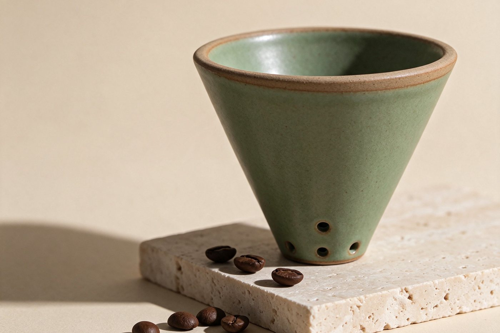</a>

Leaves negative space for copy. Check the small product details against the real item: we asked for 3 base holes and got 4 side holes.

```text
A studio product photograph of a ceramic pour-over coffee dripper with a matte sage-green glaze, an unglazed raw rim and a small three-hole base. It stands on a pale travertine slab, viewed from slightly above at about 20 degrees, filling half the frame on the right, with the left half left as clean negative space. Warm beige seamless backdrop. Soft key light from a large softbox at upper right, gentle fill from the left, a thin rim light separating the rim from the backdrop; a soft natural shadow falls to the lower left. A few roasted coffee beans rest loosely near the base, softly out of focus.
Exclusions: no text, no logos, no second dripper.
```

```bash
python $S generate --size 1:1 --prompt-file prompt.txt --name studio_product_hero_with_copy_space
```
<br clear="right">

### Row of identical items

<a href="../evidence/img/rows.txt">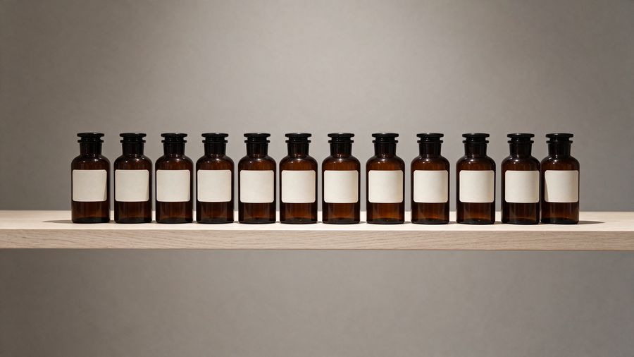</a>

A simple row of 12 came out exact. In busy layouts, the count holds but the items stop matching.

```text
A studio product photograph of exactly twelve identical amber glass apothecary bottles with black caps, standing in one straight evenly spaced row on a white oak shelf, seen straight on at eye level against a warm grey wall. Every bottle is the same height, shape and label position. Soft even light from above. Exclusions: no text, no other objects.
```

```bash
python $S generate --size 16:9 --prompt-file prompt.txt --name row_of_identical_items
```
<br clear="right">

### Product ad from two references

<a href="../evidence/img/r2_ad_v1.txt">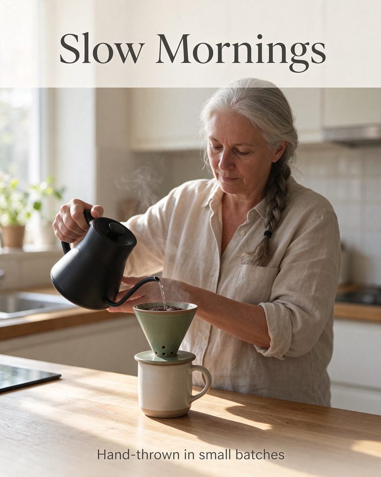</a>

The product and the person come through faithfully. It invented a saucer here; add 'no saucer, no base plate; it sits inside the mug like a funnel in a jar'.

```text
A photorealistic magazine print advertisement, portrait 4:5, for a small ceramics studio's hand-made pour-over coffee dripper. Image 1 provides the product: the dripper's exact shape, proportions, glaze colour and finish. Keep it exactly as in Image 1: a plain, wide inverted cone with straight sloping walls and no handle and no flange, a soft sage-green matte glaze speckled faintly, a thin band of bare tan speckled stoneware around the rim lip, an unglazed tan foot, and a small cluster of round drain holes near the base (one hole with three in a row beneath it). Ignore Image 1's background, stone tile, coffee beans and lighting. Image 2 provides only the woman: keep her face, age, silver-grey hair worn in a long loose braid, and her relaxed oatmeal linen shirt with rolled sleeves exactly as in Image 2. Ignore Image 2's pottery studio, clay, apron, potter's wheel and dim lighting.

The scene: the woman stands at a pale oak kitchen counter in a bright, sunlit kitchen on a calm morning, slowly pouring hot water from a matte black gooseneck kettle held in her hand. The thin stream of water falls into the sage-green dripper, which sits nested in the mouth of a plain off-white stoneware mug on the counter, with dark wet coffee grounds blooming inside the dripper and a wisp of steam rising. Her expression is calm and focused, eyes on the pour.

Layout: the dripper and mug sit in the lower-middle foreground, sharp and clearly readable, the dripper large enough to fill about a sixth of the frame. The woman is in the middle ground at waist-up, slightly image-right, her arm and the kettle spout reaching over the dripper. The top fifth of the frame is calm, uncluttered warm-white wall with soft sunlight, kept empty for the headline. A narrow clear band of counter at the very bottom is kept empty for the tagline.

Materials: matte glazed ceramic with fine speckles, raw stoneware, soft linen, oiled oak, a few green leaves of a potted herb on the windowsill. Lighting: warm low morning sunlight streaming through a window on the image-left, raking across the counter, soft golden highlights on the dripper's glaze and the steam, gentle natural fill, airy and bright. Camera: 50mm lens at f/2.8, eye level slightly above the counter, the dripper in crisp focus, the woman in gentle focus, background softly blurred. Style: natural editorial lifestyle photography, real skin texture, light warm grade with soft creams and sage greens.

Exact text: at the top, centred in the empty wall area, the headline "Slow Mornings" in a large elegant serif typeface, deep charcoal colour, the biggest element of text. At the bottom, centred in the clear band, a small tagline "Hand-thrown in small batches" in a light sans-serif, charcoal, about one quarter the height of the headline. Every word is spelled exactly as quoted and nothing else is written.

Exclusions: no other text, no logos, no watermark, no other people, no paper filter, no second dripper.
```

```bash
python $S generate --size 4:5 --image product.jpg --image model.jpg --prompt-file prompt.txt --name product_ad_from_two_references
```
<br clear="right">

## Text & design

### Event poster with exact text

<a href="../assets/gallery/poster.txt">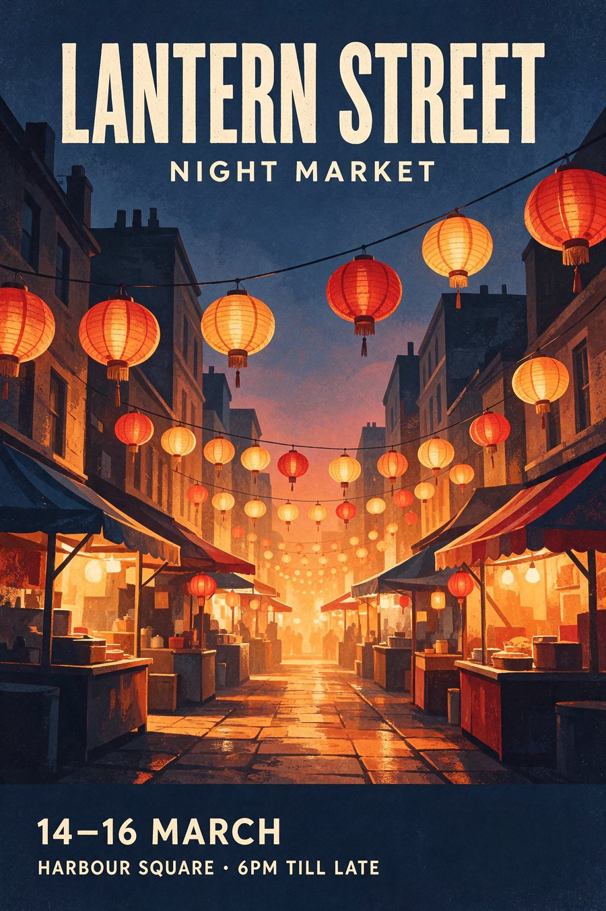</a>

Every string in quotes, with its position and rank in the hierarchy, and "nothing else is written".

```text
An A2 portrait event poster for a night market. The top third holds the headline "LANTERN STREET"
in tall condensed bold capitals, warm cream, centred, with "NIGHT MARKET" directly below it in a
smaller spaced-out sans serif. The middle holds the key visual: a narrow street seen from street
level at dusk, strings of round paper lanterns in amber and red zig-zagging overhead toward a
glowing vanishing point, food stall awnings on both sides, a soft haze catching the light. The
bottom band is a solid deep navy strip holding, left-aligned in cream, "14–16 MARCH" on the first
line and "HARBOUR SQUARE · 6PM TILL LATE" on the second. Palette of navy, amber, red and cream,
with a light risograph print grain over the whole poster. Every word is spelled exactly as quoted
and nothing else is written.
Exclusions: no extra text, no logos, no watermark, no people in the foreground.
```

```bash
python $S generate --size 2:3 --prompt-file prompt.txt --name event_poster_with_exact_text
```
<br clear="right">

### Chinese calligraphy poster

<a href="../evidence/img/c_chinese.txt">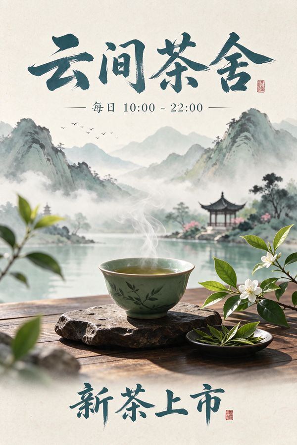</a>

Written in Chinese. Add 不要印章 if you don't want the seal stamps it adds on its own.

```text
一张竖版中式茶馆海报。顶部是大号书法标题"云间茶舍"，下方小字"每日 10:00 - 22:00"。画面中央是一只青瓷茶杯，热气袅袅，背景是淡墨山水。底部写着"新茶上市"。整体为淡雅的米色与青绿色调，宣纸质感。除引号中的文字外不要出现其他文字。
```

```bash
python $S generate --size 2:3 --prompt-file prompt.txt --name chinese_calligraphy_poster
```
<br clear="right">

### Infographic with exact numbers

<a href="../evidence/img/c_infographic.txt">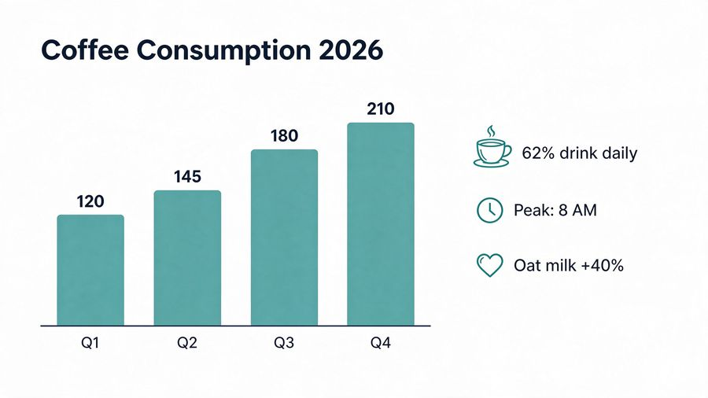</a>

Labels and values are exact. Bar heights are only roughly proportional, so use a real chart for data.

```text
A clean 16:9 infographic slide on a white background. Title at the top, left-aligned in bold dark navy: "Coffee Consumption 2026". Below it, a vertical bar chart with exactly four bars of increasing height in teal, labelled underneath from left to right "Q1", "Q2", "Q3", "Q4", with the values "120", "145", "180", "210" printed above each bar. On the right third, three stacked icon rows: a coffee cup icon with the label "62% drink daily", a clock icon with "Peak: 8 AM", and a heart icon with "Oat milk +40%". Flat vector style, thin lines, generous whitespace, one teal accent colour. Every word and number is spelled exactly as quoted and nothing else is written.
```

```bash
python $S generate --size 16:9 --prompt-file prompt.txt --name infographic_with_exact_numbers
```
<br clear="right">

### Key art with title text

<a href="../assets/gallery/hero.txt">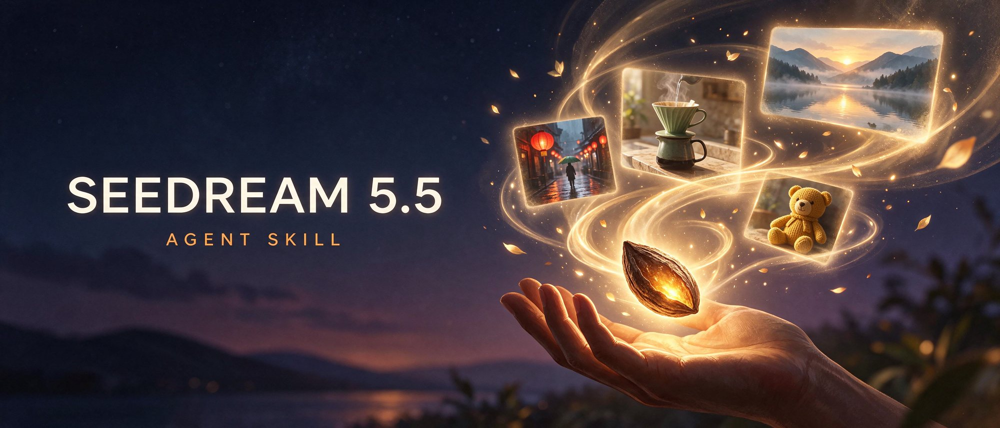</a>

Wide 21:9-style banner, with the title rendered by the model.

```text
A wide cinematic key art image for a software project. In the right half of the frame, a single luminous seed, the size of an almond, floats above an open palm, glowing warm amber and gold at its core. From the seed, a soft spiral of light unfurls upward and outward into a drifting cloud of small dreamlike vignettes, each like a tiny floating photograph: a sage-green ceramic coffee dripper on travertine, a rainy street strung with red paper lanterns, a hand-knitted mustard-yellow toy bear, a misty mountain lake at dawn. The left half is deep indigo night sky fading to plum, with faint stars and generous empty space. In the upper left, the title "SEEDREAM 5.5" in large clean geometric sans-serif capitals, warm white, and directly below it in smaller, widely spaced amber capitals "AGENT SKILL". Soft volumetric glow from the seed lights the palm from below; everything else stays dark and calm. Painterly but crisp, rich contrast, fine grain. Every word is spelled exactly as quoted and nothing else is written.
Exclusions: no other text, no logos, no watermark, no faces.
```

```bash
python $S generate --size 3024x1296 --prompt-file prompt.txt --name key_art_with_title_text
```
<br clear="right">

### Magazine cover

<a href="../evidence/img/r2_cover_v1.txt">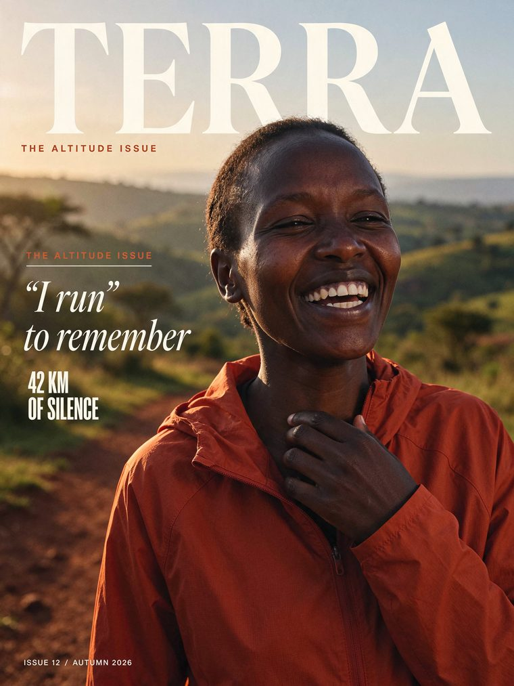</a>

Magazine-grade on the first render, apart from one duplicated cover line, which a region edit fixed. Add 'no barcode, no price' to keep it clean.

```text
The front cover of a high-end printed outdoor and endurance magazine, 3:4 portrait, photographed flat as a finished newsstand issue: a real editorial cover with a full-bleed photograph and crisp printed typography, in the style of a premium monthly.

The cover star is a Kenyan long-distance runner in her mid-thirties with deep brown skin, close-cropped natural black hair, high cheekbones and a lean, athletic build. She is caught mid-laugh, head tilted slightly back, eyes creased, a genuine open-mouthed laugh showing her teeth, one hand resting at her collarbone. She wears a rust-coloured technical running jacket (burnt orange-red, hex #B7472A) in matte ripstop nylon with a half-zip pulled partway down, fine seam taping and a slight sheen where the light catches the shoulders.

She stands outdoors on a red-earth trail in the Kenyan highlands at golden hour. Behind her, softly out of focus, roll green and ochre highland hills in layered ridges, with a few acacia silhouettes and a warm hazy sky fading from amber to pale blue.

Layout: she is framed from the chest up, centred slightly right, her head filling the middle of the frame and overlapping the bottom edge of the masthead so the top of her head sits in front of the letters, as on a real magazine cover. The top band of the sky is clear and uncluttered for the masthead. The left third of the frame beside her shoulder has calm, out-of-focus hills for cover lines.

Texture: real skin with visible pores, a light sheen of sweat on her forehead and cheekbones, fine flyaway texture in her hair, natural laugh lines; slight grain of a printed cover on coated paper.

Lighting: low late-afternoon sun from camera-left behind her, warm 3200K rim light along her cheek, ear and jacket shoulders, with soft fill from a large white bounce in front, and gentle lens flare in the upper left corner.

Camera: medium close-up at eye level, 85mm portrait lens at f/2, shallow depth of field with the background hills rendered as soft creamy bokeh, shot on medium-format digital, editorial magazine retouching that keeps the skin natural.

Style and grade: warm, rich, natural colour with deep earthy reds and golds, soft highlight roll-off, true blacks, a restrained editorial palette of rust, cream white and charcoal.

Exact text, printed on the cover:
At the very top, spanning almost the full width, the masthead "TERRA" in huge, tall, high-contrast Didone serif capitals in cream white, the largest element on the cover.
On the left side, under the masthead, a small kicker in a bold spaced sans-serif, rust on a thin cream rule: "THE ALTITUDE ISSUE".
On the left at mid-height, a pull quote in large elegant italic serif, cream white, with typographic quotation marks, on two lines: "I run" / "to remember".
Lower on the left, a cover line in a condensed bold sans-serif, cream white, on two lines: "42 KM" / "OF SILENCE".
In the bottom-left corner, small, in a thin sans-serif, cream white: "ISSUE 12 / AUTUMN 2026".
Every word is spelled exactly as quoted and nothing else is written.

Exclusions: no other text, no barcode, no price, no logos, no watermark, no plastic or airbrushed skin, no extra people.
```

```bash
python $S generate --size 1860x2480 --prompt-file prompt.txt --name magazine_cover
```
<br clear="right">

## Characters

### Character sheet with an asymmetric detail

<a href="../assets/gallery/bramble_sheet.txt">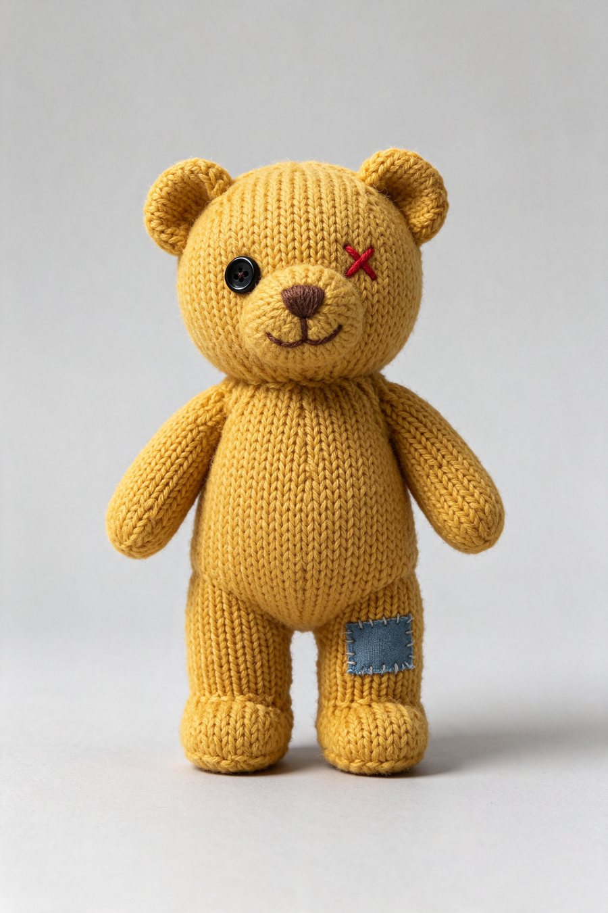</a>

The count (one eye) holds. The side may come out mirrored, so check it and flip with export.py if needed.

```text
A full-body character reference of Bramble, a hand-knitted toy bear about 30 cm tall in chunky
mustard-yellow wool with visible stitches, short rounded ears and a slightly lopsided smile in
brown thread. Bramble has exactly one eye: a single shiny black button on the toy's left side of
the face; on the right side, where the second eye would be, there is a small stitched X in red
thread. A faded blue patch is sewn onto the left knee. Neutral standing pose, arms slightly away
from the body, facing the camera, whole figure visible with space around it. Plain light-grey
seamless backdrop, soft even studio light, sharp focus throughout.
Exclusions: no second eye, no props, no other characters, no text.
```

```bash
python $S generate --size 2:3 --prompt-file prompt.txt --name character_sheet_with_an_asymmetric_detai
```
<br clear="right">

### Two characters from two reference sheets

<a href="../assets/gallery/reading.txt">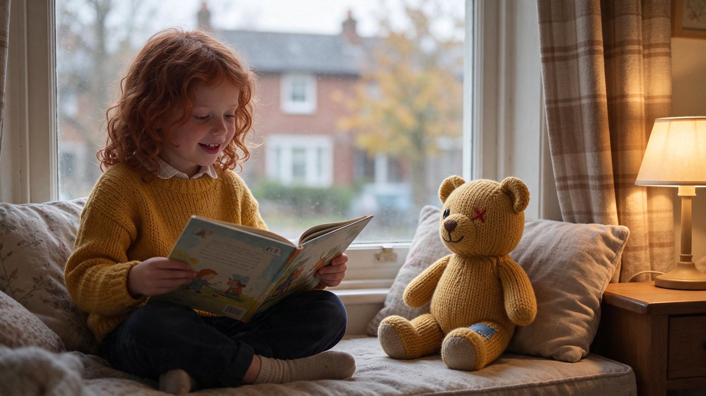</a>

Each reference has a role and a place in the frame.

```text
A warm photorealistic image. Image 1 provides Bramble the knitted bear: keep the single button
eye on the toy's left, the red stitched X on the right, the mustard wool and the blue knee patch
exactly. Image 2 provides Mila, the child: keep her face, curly auburn hair and yellow jumper
exactly. Mila sits on the left of frame on a window seat, reading a picture book aloud; Bramble
sits on the right of frame propped against a cushion, facing her. Soft grey daylight from the
window behind them, warm lamp glow from the right. Medium shot at eye level on a 40mm lens,
gentle depth of field.
Exclusions: no other people, no readable text on the book, no second eye on the bear.
```

```bash
python $S generate --size 16:9 --image bramble_sheet.png --image mila_sheet.png --prompt-file prompt.txt --name two_characters_from_two_reference_sheets
```
<br clear="right">

### Three people from three references

<a href="../evidence/img/c_threerefs.txt">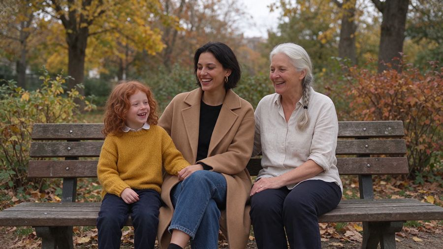</a>

All three identities held, with no bleed.

```text
A photorealistic medium-wide shot of three people sitting together on a park bench in autumn, laughing. Image 1 provides the girl: keep her face, curly auburn hair, freckles, mustard knitted jumper exactly; she sits on the image-left. Image 2 provides the woman: keep her face, short black hair and single gold hoop earring exactly; she sits in the middle, wearing a camel coat. Image 3 provides the older woman: keep her face, silver braid and linen shirt exactly; she sits on the image-right. Soft overcast light, 35mm lens. Exclusions: no other people, no text.
```

```bash
python $S generate --size 16:9 --image girl.png --image woman.png --image older_woman.png --prompt-file prompt.txt --name three_people_from_three_references
```
<br clear="right">

## Editing

### One-change edit

<a href="../assets/gallery/reading_scarf.txt">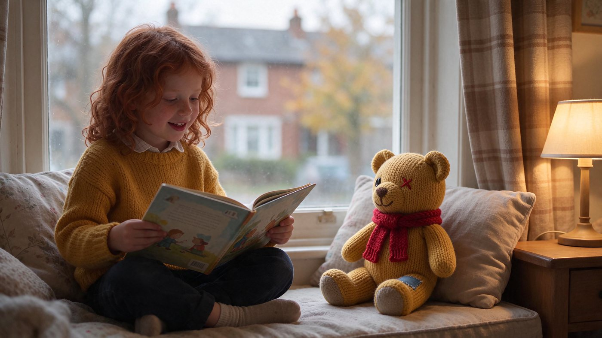</a>

Changes one thing and repeats the full keep-list. Run export.py merge afterwards to keep untouched pixels original.

```text
Image 1 is the current image. Change only one thing: Bramble now wears a tiny red knitted scarf
wrapped once around the neck, its ends hanging over the chest. Keep everything else exactly as in
Image 1: Mila's face, hair, jumper and pose, Bramble's single button eye and red stitched X exactly where
they are in Image 1, the window seat, the lighting and the framing. Image 2 is Bramble's
identity reference only.
Exclusions: no other changes, no second eye on the bear, no text.
```

```bash
python $S generate --size 16:9 --image reading.png --image bramble_sheet.png --prompt-file prompt.txt --name one_change_edit
```
<br clear="right">

### Edit chain, round 3

<a href="../evidence/img/edit3.txt">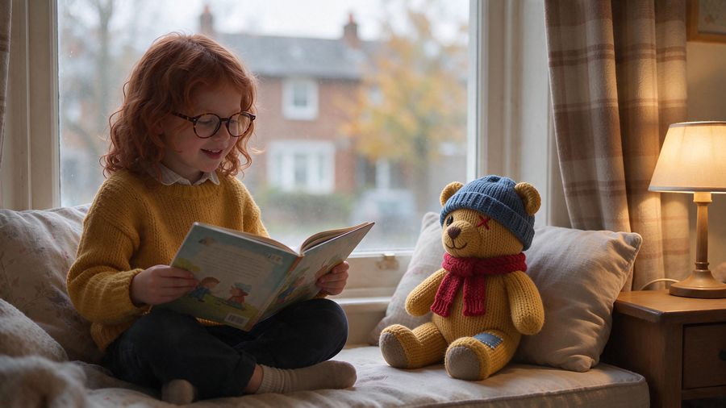</a>

The face is unchanged after 3 rounds.

```text
Image 1 is the current image. Change only one thing: Mila now wears round tortoiseshell glasses. Keep everything else exactly as in Image 1: Mila's face, hair, jumper and pose, Bramble's beanie, red scarf, single button eye and red stitched X exactly where they are in Image 1, the window seat, the lighting and the framing. Exclusions: no other changes, no text.
```

```bash
python $S generate --size 16:9 --image edit2.png --image bramble_sheet.png --prompt-file prompt.txt --name edit_chain_round_3
```
<br clear="right">

### Precision edit: swap, rewrite, remove

<a href="../evidence/img/r2_cafe_edit.txt">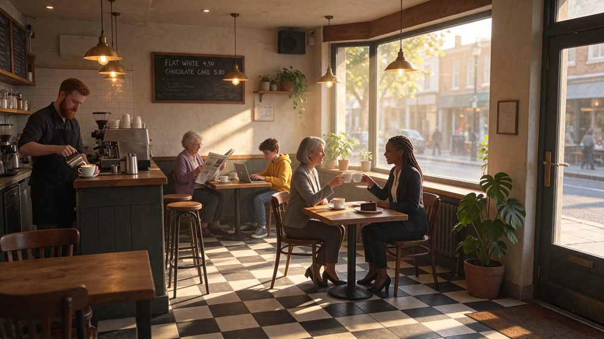</a>

Three named changes and a full keep-list, all exact in one render. Then run export.py merge cafe.jpg <edit> so the untouched 93% stays original.

```text
Image 1 is a photograph of our café, used on our website. Make exactly three edits and nothing else.

Edit 1: On the centre table between the two women, replace only the croissant inside <bbox>578 584 640 634</bbox> with a single triangular slice of rich chocolate layer cake with glossy dark chocolate ganache, sitting on the same small white plate in the same spot. Keep the plate's shape, size, position and shadow, and keep the cups, saucers and table exactly as they are.

Edit 2: On the large black chalkboard on the back wall inside <bbox>251 154 405 306</bbox>, rewrite the two large lines of white chalk lettering. The first line reads "FLAT WHITE 4.50" and the second line reads "CHOCOLATE CAKE 5.80", in the same hand-drawn white chalk capitals, same size, same position and same left alignment as the existing two lines. Every word and number is spelled exactly as quoted. Keep the wooden frame, the faint small chalk scribbles below the two lines, and the board's position unchanged.

Edit 3: Remove the sleeping ginger cat from the windowsill inside <bbox>714 495 780 566</bbox>. Fill the area with the empty wooden windowsill, the window glass and the street view behind it, continuing the existing sunlight and shadows naturally.

Keep everything else exactly as in Image 1: all people, faces, poses and clothing, the barista, the furniture, pendant lamps, plants, checkered floor, windows, street view, door, warm golden late-afternoon lighting, colour grade, framing and camera angle. Same composition and same aspect ratio.

Exclusions: no other changes, no new objects, no extra text anywhere.
```

```bash
python $S generate --size 2560x1440 --image cafe.jpg --prompt-file prompt.txt --name precision_edit_swap_rewrite_remove
```
<br clear="right">

### Edit chain: change the season

<a href="../evidence/img/r2_chain1.txt">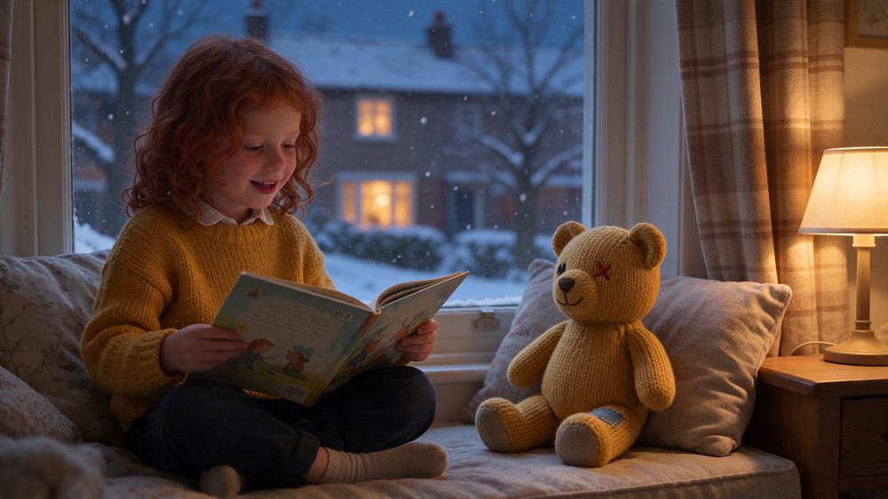</a>

Step 1 of 3. The next steps use the previous output as Image 1 and the original as an identity-only reference.

```text
A still from a children's animated film pitch. Image 1 is the current image. Change only one thing: the view outside the window becomes a snowy winter evening. The sky outside is deep blue dusk, snow is gently falling, snow lies on the rooftops, the chimneys, the bare tree branches and the hedges, and the house across the street has warm yellow lit windows. The interior keeps its warm lamp glow, contrasting with the cool blue light outside.
Keep everything else exactly as in Image 1. The girl stays the same character: same face, freckles, curly red hair, mustard-yellow knitted jumper with a checked collar, dark trousers, cream socks, the same cross-legged pose and the same open picture book in her hands. The knitted mustard-yellow teddy bear stays the same character: it has exactly one black button eye, on the image-left side of its face, and a red stitched X on the image-right side of its face where the other eye was (the bear's own left eye); keep its brown stitched nose, smile, the blue patch on its leg on the image-right, and its sitting pose against the cushion. Keep the window frame, plaid curtains, glowing table lamp, cushions, window seat, room interior, camera angle, framing and composition unchanged.
Exclusions: no other changes, no second eye on the bear, no text, no extra people.
```

```bash
python $S generate --size 2560x1440 --image reading.jpg --prompt-file prompt.txt --name edit_chain_change_the_season
```
<br clear="right">

### Translate a poster

<a href="../evidence/img/r3_poster_es.txt">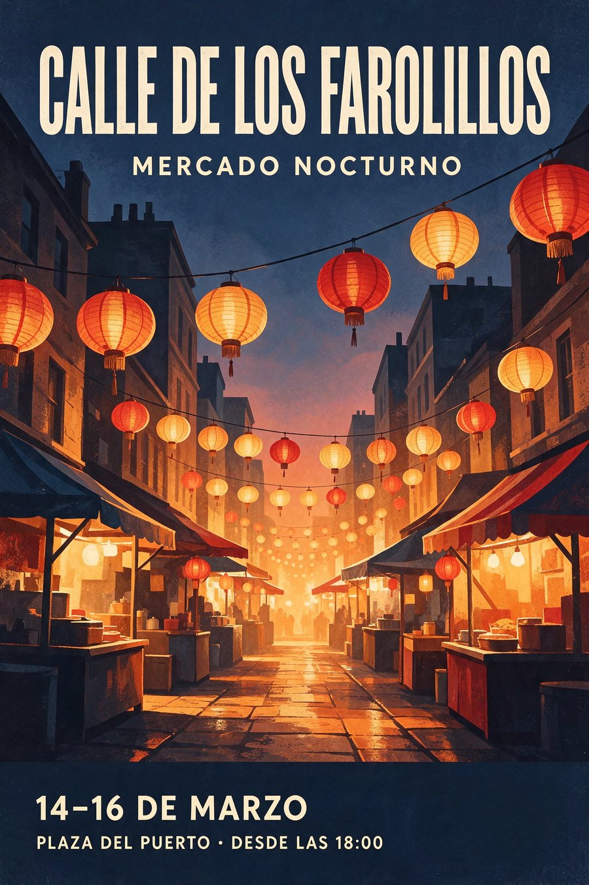</a>

Spell out every translated line yourself. Then run export.py merge so the artwork stays pixel-identical.

```text
Image 1 is a finished event poster. Translate only its text into Spanish, keeping each line in the same position, the same cream colour, the same bold condensed typeface and the same relative size:
"LANTERN STREET" becomes "CALLE DE LOS FAROLILLOS"; "NIGHT MARKET" becomes "MERCADO NOCTURNO"; "14-16 MARCH" becomes "14-16 DE MARZO"; "HARBOUR SQUARE · 6PM TILL LATE" becomes "PLAZA DEL PUERTO · DESDE LAS 18:00".
Keep the street, lanterns, stalls, colours, lighting and composition exactly as in Image 1. Every word is spelled exactly as quoted and nothing else is written.
```

```bash
python $S generate --size 2:3 --image poster.jpg --prompt-file prompt.txt --name translate_a_poster
```
<br clear="right">

## UI & web

### Mobile app screen

<a href="../evidence/img/r3_ui_app.txt">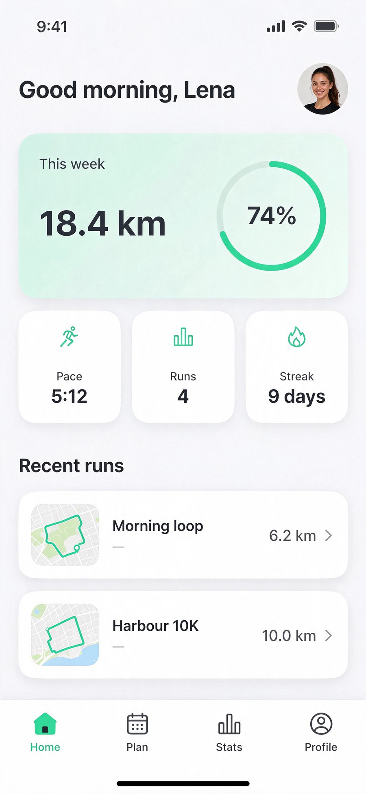</a>

Written like a spec: every region top to bottom, every label quoted, hex colours, grid and corner radius. All 20 labels came out exact.

```text
A high-fidelity mobile app UI screen, flat front-on screenshot of an iPhone app (no phone frame, no hand, no perspective), for a design review. The app is "Stride", a running tracker, light mode.
Layout from top to bottom: a status bar showing "9:41"; a header with the large bold title "Good morning, Lena" left-aligned and a round avatar on the right; one large rounded card with a soft mint-green background showing the label "This week" and the big number "18.4 km" with a thin progress ring on its right labelled "74%"; a row of three equal small cards labelled "Pace 5:12", "Runs 4" and "Streak 9 days"; a section title "Recent runs"; two list rows, each with a small route-map thumbnail on the left, the title "Morning loop" or "Harbour 10K", and the distance "6.2 km" or "10.0 km" on the right; at the bottom a tab bar with four icons labelled "Home", "Plan", "Stats", "Profile", with "Home" highlighted.
Style: clean modern iOS design, 8-point spacing grid, generous white space, rounded corners 16 px, one accent colour (mint green #3DDC97) on near-white #F7F8FA, dark grey text #1C1C1E, a geometric sans-serif typeface, crisp vector edges, consistent icon stroke weight.
Every word is spelled exactly as quoted and nothing else is written. No phone frame, no device mockup, no watermark, no lorem ipsum.
```

```bash
python $S generate --size 1290x2796 --prompt-file prompt.txt --name mobile_app_screen
```
<br clear="right">

### Dark mode from the light screen

<a href="../evidence/img/r3_ui_dark.txt">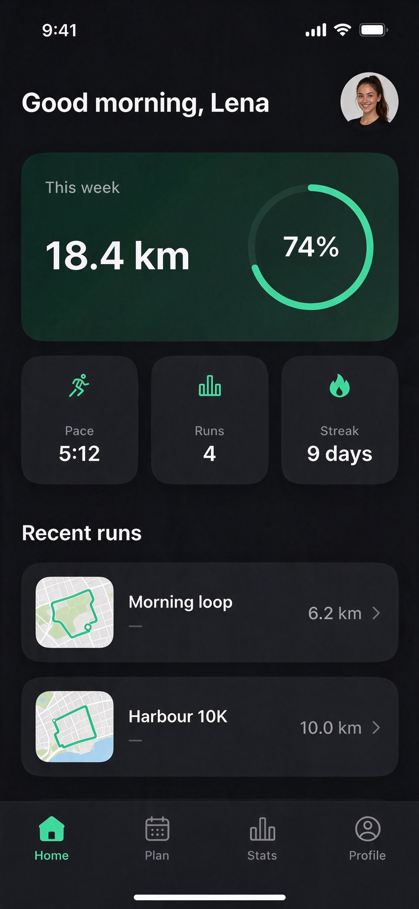</a>

One colour per role and 'keep every element exactly'. Nothing moved.

```text
Image 1 is a light-mode mobile app screen. Create the dark-mode version of the same screen: keep every element, its position, size, text, icon and the mint-green accent #3DDC97 exactly as in Image 1, and change only the colours: background #0E0F12, cards #1A1C21, primary text #F2F2F7, secondary text #8E8E93, the weekly card becomes a deep green-tinted #12271F. Keep the avatar photo and the map thumbnails as they are. Every word stays spelled exactly as in Image 1 and nothing else is written.
```

```bash
python $S generate --size 1290x2796 --image mobile_app_screen.png --prompt-file prompt.txt --name dark_mode_from_the_light_screen
```
<br clear="right">

### SaaS landing page

<a href="../evidence/img/r3_web_landing.txt"></a>

Strong result, with one trap: 'grey placeholder customer logos' produced real brand logos. Write 'plain grey rounded rectangles, no letters, no real brands' instead.

```text
A high-fidelity desktop website landing page design, flat front-on full-browser-width screenshot (no browser chrome, no laptop, no perspective), for a design review. The product is "Ledgerly", bookkeeping software for freelancers.
Layout top to bottom: a slim white navigation bar with the wordmark "Ledgerly" on the left and the links "Product", "Pricing", "Customers", "Log in" on the right next to a solid indigo button "Start free"; a hero section on a very light lavender background with the left half holding the headline "Books done before your coffee cools" in large bold type over two lines, the sub-line "Invoices, receipts and taxes in one calm place." in grey, and two buttons "Start free" (solid indigo #4F46E5) and "Watch demo" (outlined); the right half holds a floating product dashboard card showing a line chart and the figure "$12,480" labelled "Paid this month"; below the hero a row of five grey placeholder customer logos; then three feature cards in a row titled "Snap receipts", "Auto invoices" and "Tax-ready", each with a small indigo line icon and one grey line of text.
Style: modern SaaS design, 12-column grid, 1200 px content width centred, generous white space, rounded corners 12 px, a geometric sans-serif typeface, crisp vector edges, subtle soft shadows on cards.
Every word is spelled exactly as quoted; feature card lines and logos may be short grey placeholder bars instead of words. No browser frame, no device mockup, no watermark, no lorem ipsum.
```

```bash
python $S generate --size 2560x1600 --prompt-file prompt.txt --name saas_landing_page
```
<br clear="right">

### Dark analytics dashboard

<a href="../evidence/img/r3_web_dashboard.txt">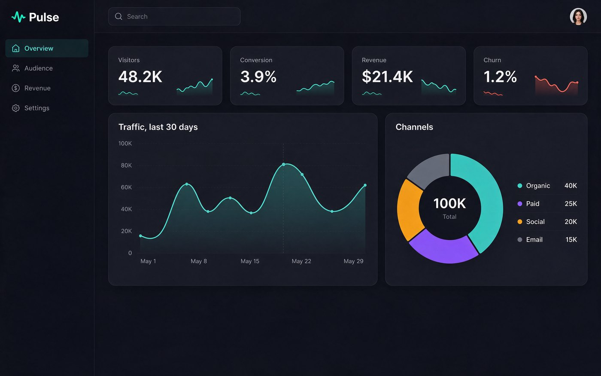</a>

Exact labels. It added legend values and axis labels on its own, and left the bottom third empty, so describe enough content to fill the frame.

```text
A high-fidelity web app dashboard UI, flat front-on screenshot (no browser chrome, no perspective), dark mode, for a design review. Product: "Pulse", an analytics tool.
Layout: a narrow left sidebar (#0F1117) with the wordmark "Pulse" at the top and a vertical menu "Overview" (highlighted), "Audience", "Revenue", "Settings", each with a small line icon; a top bar with a search field reading "Search" and a round avatar on the right; the main area (#151821) holds a row of four KPI cards labelled "Visitors 48.2K", "Conversion 3.9%", "Revenue $21.4K", "Churn 1.2%", each with a tiny sparkline; below, a large area chart card titled "Traffic, last 30 days" with a smooth teal (#2DD4BF) line and soft gradient fill; to its right a donut chart card titled "Channels" with four segments and a legend "Organic", "Paid", "Social", "Email".
Style: modern dark SaaS UI, 8-point grid, rounded corners 12 px, thin 1 px borders #262A36, light grey text #E5E7EB, a geometric sans-serif, crisp vector edges. Every word is spelled exactly as quoted and nothing else is written. No device mockup, no watermark.
```

```bash
python $S generate --size 2560x1600 --prompt-file prompt.txt --name dark_analytics_dashboard
```
<br clear="right">

### App screen on a phone, for marketing

<a href="../evidence/img/r3_ui_mockup.txt">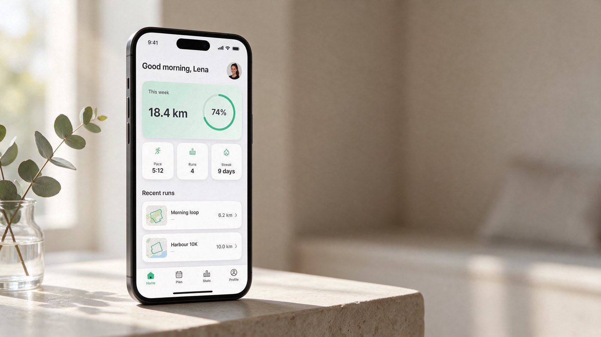</a>

The screenshot as Image 1, 'showing exactly the app screen from Image 1, undistorted'. The screen stayed legible.

```text
Image 1 is our app screen. A marketing hero image: a modern smartphone with thin black bezels standing upright at a slight three-quarter angle on a pale stone surface, its screen showing exactly the app screen from Image 1, undistorted, with every word legible. Soft morning window light from the image-left, a sprig of eucalyptus in a small glass beside it, gentle shadow, warm neutral background with empty space on the right third for a headline. Product photography, 85mm lens, shallow depth of field on the background only; the phone screen stays sharp. No text other than what is on the screen, no logos on the phone.
```

```bash
python $S generate --size 16:9 --image mobile_app_screen.png --prompt-file prompt.txt --name app_screen_on_a_phone_for_marketing
```
<br clear="right">

## Games & events

### Game HUD over gameplay

<a href="../evidence/img/r3_game_hud.txt">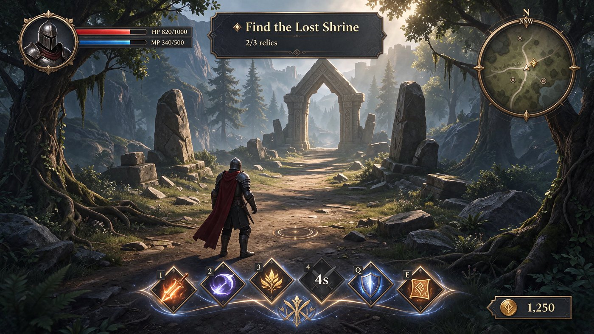</a>

Scene first, then the HUD region by region, with every number and keybind quoted. Check the corners: the minimap added an 'NNW' label.

```text
A game UI design mockup: the in-game HUD of a stylised fantasy action RPG, shown over a gameplay screenshot of a misty forest clearing with the player's armoured hero seen from behind in third person, for a UI design review. Landscape 16:9.
HUD layout: top-left a circular character portrait with a red health bar labelled "HP 820/1000" and a blue mana bar labelled "MP 340/500" beside it; top-right a round minimap with a gold compass "N" marker; top-centre a quest tracker reading "Find the Lost Shrine" with "2/3 relics" beneath; bottom-centre an ability bar of six square ability slots with glowing icons and the keybinds "1", "2", "3", "4", "Q", "E" in small corners, one slot greyed on cooldown showing "4s"; bottom-right a small gold coin counter reading "1,250".
Style: ornate but readable fantasy UI, dark slate panels with thin antique-gold trim, crisp edges, consistent icon style, legible text with subtle drop shadows. Every word is spelled exactly as quoted and nothing else is written. No watermark, no real game logos.
```

```bash
python $S generate --size 2560x1440 --prompt-file prompt.txt --name game_hud_over_gameplay
```
<br clear="right">

### Kiosk ordering screen

<a href="../evidence/img/r3_kiosk.txt">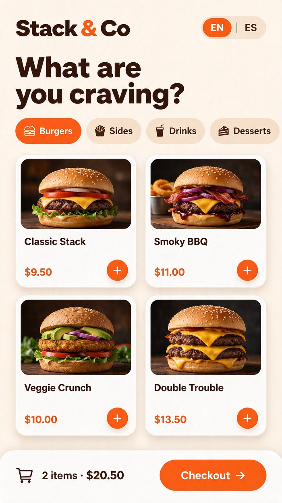</a>

Gives the viewing distance and a minimum touch target, so the layout comes out big and high-contrast. Every price exact.

```text
A self-service ordering kiosk screen UI for a burger restaurant called "Stack & Co", flat front-on portrait screenshot of the touchscreen (no kiosk hardware, no hands, no perspective), for a design review. Portrait 9:16, designed to be read from 60 cm away with big touch targets.
Layout top to bottom: a header with the wordmark "Stack & Co" and a language toggle "EN | ES"; a large title "What are you craving?"; a horizontal row of category tabs "Burgers" (selected), "Sides", "Drinks", "Desserts"; a 2-column grid of four large product cards, each with an appetising photo of the item, its name and price: "Classic Stack $9.50", "Smoky BBQ $11.00", "Veggie Crunch $10.00", "Double Trouble $13.50", each with a round "+" button; at the bottom a full-width sticky bar showing "2 items · $20.50" and a large orange button "Checkout".
Style: bold, friendly, high contrast, warm orange #FF6B2C accent on cream #FFF8F0, dark brown text, rounded corners 24 px, minimum touch target 88 px, a chunky geometric sans-serif. Every word is spelled exactly as quoted and nothing else is written. No device frame, no watermark, no real brand logos.
```

```bash
python $S generate --size 1440x2560 --prompt-file prompt.txt --name kiosk_ordering_screen
```
<br clear="right">

### Stage LED wall, 32:9

<a href="../evidence/img/r3_event_stage.txt">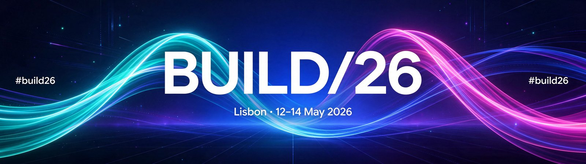</a>

Uses the exact wall ratio as WxH, keeps the centre third clean, and says 'no sponsor logos'.

```text
A conference stage backdrop screen graphic for a tech event called "BUILD/26", ultra-wide 32:9 LED wall design, flat front-on artwork (no stage, no people, no room), for print and screen production.
Layout: the large event logotype "BUILD/26" in the centre in bold white geometric letters, beneath it the line "Lisbon · 12-14 May 2026" in smaller letters, and at the far left and far right edges the hashtag "#build26" in small text. Background: deep midnight-blue to violet gradient with flowing luminous teal and magenta light ribbons sweeping behind the logotype, subtle fine grid lines in perspective at the bottom.
Keep the centre third clean and high contrast so it reads from 40 metres away. Every word is spelled exactly as quoted and nothing else is written. No sponsor logos, no watermark.
```

```bash
python $S generate --size 3584x1008 --prompt-file prompt.txt --name stage_led_wall_32_9
```
<br clear="right">

### Speaker badge

<a href="../evidence/img/r3_event_badge.txt">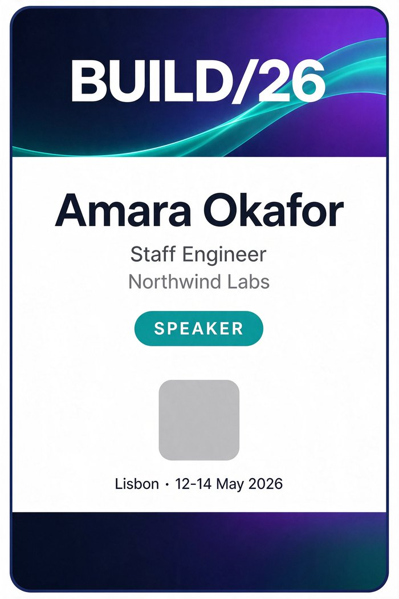</a>

Asks for a plain grey square where the QR code goes. Paste the real QR code in afterwards.

```text
A conference attendee badge design for "BUILD/26", flat front-on print artwork of the badge only (no lanyard photo, no hand, no perspective), portrait 2:3, for print production.
Layout: top band with the logotype "BUILD/26" in white on a deep midnight-blue to violet gradient with a teal light ribbon; a large white area with the attendee name "Amara Okafor" in big bold dark letters, below it "Staff Engineer" and "Northwind Labs" in smaller grey; a teal pill-shaped tag reading "SPEAKER"; at the bottom a square QR-code placeholder drawn as a plain grey square with rounded corners, and the line "Lisbon · 12-14 May 2026".
Style: clean modern event branding, generous margins, geometric sans-serif. Every word is spelled exactly as quoted and nothing else is written. No real QR code pattern, no barcode, no sponsor logos, no watermark.
```

```bash
python $S generate --size 2:3 --prompt-file prompt.txt --name speaker_badge
```
<br clear="right">

## Assets

### Icon set on one sheet

<a href="../evidence/img/r3_icons.txt">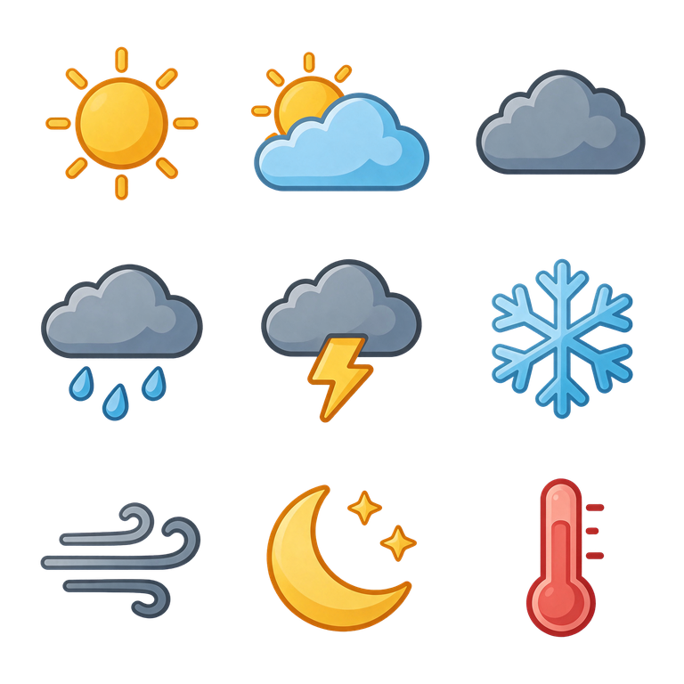</a>

One render keeps the style consistent. Then: python export.py split icons.png --square --names sun,partly_cloudy,...

```text
A set of 9 app icons for a weather app, arranged in a clean 3 by 3 grid with equal spacing, each icon centred in its own cell, for use as separate UI assets.
Icons, row by row: sun; sun partly behind a cloud; cloud; cloud with rain drops; cloud with a lightning bolt; snowflake; wind lines; moon with two small stars; thermometer.
Style: one consistent family: rounded filled glyphs with a 2 px darker outline, soft two-tone colouring (warm yellow for sun and moon, sky blue for rain and snow, slate grey for clouds and wind, coral for the thermometer), same visual weight and same size in every cell, flat vector look, no shadows.
Set a transparent background. No grid lines, no labels, no text, no frames around the icons.
```

```bash
python $S generate --size 1:1 --background transparent --prompt-file prompt.txt --name icon_set_on_one_sheet
```
<br clear="right">

### Transparent sticker

<a href="../assets/gallery/transparent.txt">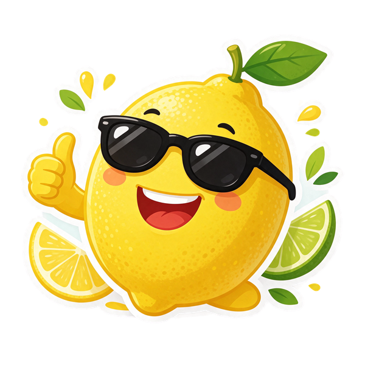</a>

A true RGBA PNG. Put "Set a transparent background." in the prompt as well.

```text
A die-cut sticker of a cheerful cartoon lemon wearing sunglasses, thick white outline, flat vector style. Set a transparent background.
```

```bash
python $S generate --size 1:1 --background transparent --prompt-file prompt.txt --name transparent_sticker
```
<br clear="right">
